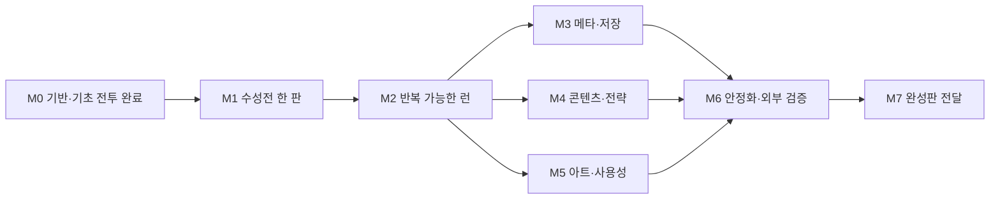

# ProjectNeo 구현 로드맵

마지막 갱신: 2026-11-12 12:28:25 (KST). **현재 위치: M1 수성전 한 판 진행 중.** `syj`의 타이틀·게임 흐름(G-0·G-1), 성벽 적층·겹친 유닛 윗면 이동과 `feature/siege-prototype`의 준비·적 침공·사다리·승패 시험 씬을 `develop`에 병합했다. `SiegePrototype`은 B-6·B-9 일부를 시험하는 별도 씬이며, 실제 `Game` 씬은 준비 1인칭·건설소 F → 성문 앞 깃발 F → 적 침공·사다리·실제 승패 → 보상/결과로 연결했다. 기존 자리표시 시작·승패 버튼은 플레이 화면에서 숨겼다. 보상 지급·정식 스테이지 편성·손실 보충은 후속이다. 팀원은 적 침공·전투 한 판, 사용자는 게임 진입·전체 흐름을 맡으며 상세는 6.1을 따른다. 일반 성벽 파괴 적·비행 적, 웨이브·사기, 수성 무기 동작(Q-21)은 남아 있다. Q-09는 패배 우선으로 확정했다. M2 준비로 C-1a 런 데이터·전투 입출력 규칙을 완료했으며(5.6), Game 씬 연결은 다음 작업이다.

이 문서는 완성 목표, 개발 순서, 현재 상태, 가까운 작업과 세 명의 분업 계획을 관리한다. 기획 원문은 [GameDesign.md](GameDesign.md), 현재 코드·실행 방법·개발 원칙·Unity CLI와 과거 검증 기록은 [Context.md](Context.md)를 본다. Docs는 컨텍스트·구현 로드맵·게임 기획 세 문서로 유지한다.

## 1. GOAL: 어떤 상태를 게임의 완성으로 볼 것인가

### 1.1 최종 목표

**다음 적 웨이브를 보고 영웅·병력·장비·성벽을 준비한 뒤, 플레이어가 직접 싸우고 부대를 지휘해 성을 지키며, 손실과 보상을 다음 전투로 이어가는 수성전 로그라이크를 완성한다.** 런이 끝나면 해금과 퍽 포인트가 남아 새로운 구성으로 다시 도전할 수 있어야 한다.

기능 목록을 구현한 것에 더해, 처음 접하는 사람이 게임 안의 안내로 이 흐름을 이해하고 처음부터 정해진 런 종료까지 플레이하며 다시 시작할 수 있어야 한다. 최종 아트·소리·화면과 안정성을 갖춘 실행 파일로 다른 사람에게 전달해 시험할 수 있는 상태를 목표로 한다.

출시 플랫폼·배포처·목표일·최종 콘텐츠 규모는 **미정**이다. 현재 Windows 빌드 경로가 있다는 사실과 최종 출시 플랫폼 확정은 구분한다. 이 계획에는 근거 없는 날짜와 최종 스테이지 수를 넣지 않는다. 런의 끝도 아직 미정이므로 특정 보스·클리어 방식을 확정하지 않는다.

### 1.2 최종 완료 조건

다음은 개발 완료를 판단하기 위한 작업 기준이다. 수치 목표나 새로운 기획이 필요한 부분은 2장에서 확정한 뒤 구체화한다.

| 축 | 완성판에서 확인할 것 |
|---|---|
| 핵심 재미 | 웨이브 정보를 보고 준비를 바꾸는 것이 전투 결과에 영향을 준다. 정답 하나를 반복하기보다 여러 편성·장비·성벽 조합을 시험할 이유가 있다. 플레이테스트에서 확인한다. |
| 수성전 | 지면·성벽 위 전투, 파괴와 길 변화, 부대 이동·공격·중지, 서로 다른 적의 접근, 사기·도망과 승패가 함께 작동한다. |
| 준비와 성장 | 시설에서 고용·모집·거래·장비·수성·편성을 수행하고 전투 결과와 다음 준비에 반영한다. 스킬과 퍽의 실제 효과가 연결된다. |
| 런의 완결 | 시작 → 준비 → 전투 → 보상 → 다음 스테이지 → 확정된 종료 규칙 → 결과 → 재도전이 끊기지 않는다. 성벽 피해·영웅 사망·잡졸 손실과 복귀를 정확히 이월한다. |
| 메타와 저장 | 지휘관 경험치·퍽 포인트·해금 포인트·해금 정보가 종료 후에도 보존된다. 새 런에서는 찍은 퍽을 초기화한다. 저장 실패·손상·버전 변경의 처리 방침을 갖춘다. |
| 콘텐츠와 표현 | 확정된 초기 완성판 범위의 영웅·적·스테이지·아이템·퍽을 제공한다. 공격·위협·지휘·피해·사망·도망을 화면과 소리로 구분할 수 있다. |
| 사용성 | 첫 실행·기본 조작·지휘·준비·재도전 안내, 필요한 설정과 입력 처리, 읽을 수 있는 UI를 갖춘다. 정확한 지원 범위는 별도 결정한다. |
| 품질과 전달 | 합의한 기준 장비·병력 수·프레임 목표를 실제 모델과 애니메이션을 넣은 빌드에서 만족한다. 진행 불가·저장 손실 등 출시 차단 문제가 해결되고 실행 파일·콘텐츠 이용 권한·배포 절차를 확인한다. |

### 1.3 범위와 계획의 깊이

- **핵심 완성 범위:** 현재 기획의 수성전, 준비 시설, 런 반복, 메타 진행과 그 흐름에 필요한 UI·스킬 연결·저장·연출·검증.
- **먼저 시험할 규모:** 소수 콘텐츠로 핵심 흐름이 연결되는지 확인한다. 중간 검증의 3스테이지는 시험 구간이며 최종 런 길이가 아니다.
- **추가 판단이 필요한 조작:** 점프·방어·방향별 공격은 후속 후보다. 첫 완성판 필수 여부와 전투 깊이를 플레이테스트 뒤 정한다.
- **별도 확장 후보:** 성 밖 파밍, 영웅 충성도, 난이도 모드. 현재 GOAL의 완료를 막는 필수 기능으로 취급하지 않는다.
- **가까운 M1:** 작업별 선행 조건·산출물·검증·분업까지 상세화한다. **다음 M2·M3:** 기능 묶음과 연결 조건을 계획한다. **먼 M4 이후:** 대단원과 완료 조건만 유지하고 도착할 때 쪼갠다.

### 1.4 확정된 기획·구현 결정

게임 규칙의 상세 원문은 GameDesign에 둔다. 아래는 기존 결정과 구현에 주는 영향을 보존한 요약이다. 기획 결정이 바뀌면 원문과 영향을 함께 갱신한다.

| 항목 | 결정 | 구현에 주는 영향 |
|---|---|---|
| 아트 | 로우 폴리, Synty 에셋. 팩은 미정이며 선정 전에도 범용 구조로 진행 | 격자 크기·조각 점유 칸·높이·외형을 데이터로 분리한다. 특정 팩에 고정하지 않고 나중에 조정한다. |
| 전투 시점 | 3D 1인칭 (2026-11-11 변경) | 직접 이동·공격과 부대 지휘를 눈높이 시점에서 수행한다. 건설은 직교 시점을 유지한다. 유닛 수백이 3D로 움직이므로 성능을 처음부터 잰다. |
| 성과 맵 | 런 내내 성 하나, 성벽과 구조물은 격자 위 자유 배치 | 배치 시스템과 길찾기 갱신이 전투 프로토타입의 일부가 된다. |
| 잡졸 충원 | 훈련장에서 모집, 포로 병력 보상은 추가 수급 | 훈련장이 "강화"와 "모집" 두 기능을 가진다. |
| 몬스터 재료 | 종류가 여러 개 | 비용과 지갑이 재료를 종류별로 센다. (구현됨) |
| 퍽 효과 | 스탯 증가 외에 특수 효과도 가능 (예: 부대 사기 증진) | 퍽은 "효과 목록"을 가진다. 효과 종류를 늘릴 수 있는 구조로 바꾼다. |
| 부대 규모 | 나중에 정함 | 값은 에셋에서 바꾼다. 지금 기본값(부대 4개 × 10명)은 그대로 둔다. |
| 시설 거래 | 상점과 대장간에서 구매와 판매, 업그레이드하면 품목이 바뀜 | 시설 레벨마다 "품목 풀"을 데이터로 붙인다. 거래 로직은 시설 공통으로 만든다. |
| 런이 끝나도 유지되는 것 | 두 가지: 퍽 포인트 개수, 해금 정보(아이템, 영웅 등) | 찍은 퍽 내역은 초기화하고 포인트 개수만 남긴다. 저장 데이터는 이 둘과 그 재료(지휘관 레벨, 해금 포인트)다. |
| 퍽 포인트 | 지휘관 레벨 등으로 얻음. 지휘관 레벨은 여러 방법으로 올릴 수 있음 | "퍽 포인트를 주는 출처"와 "지휘관 경험치를 주는 출처"를 각각 여러 개 붙일 수 있게 만든다. |
| 지휘관 경험치 | 스테이지가 끝날 때마다 얻음. 레벨이 오르면 바로 퍽 포인트를 받아서 런 도중에 강해질 수 있음 | 레벨업과 퍽 포인트 지급은 스테이지 보상 때 바로 처리한다. 런 종료 때 몰아서 정산하지 않는다. |
| 환생 보너스 | 런이 끝날 때 이번 런 점수의 일정 비율을 지휘관 경험치로 환산해 줌 | 환산 비율은 데이터로 둔다. 런 점수를 무엇으로 매기는지는 런 루프(단계 C)에서 정한다. |
| 퍽 찍기 | 런 시작 때만이 아니라 언제나 찍을 수 있음. 런이 끝나면 찍은 내역만 초기화 | 남은 퍽 포인트가 있으면 언제든 찍는다. 찍는 즉시 스탯과 효과에 반영돼야 한다. |
| 해금 | 해금 포인트를 써서 랜덤으로 해금 (예: 100포인트로 영웅 하나). 해금한 영웅은 그 뒤로 주점에 등장할 수 있음. 첫 해금 시 확정 등장 같은 요소도 가능 | 해금은 "종류별 뽑기"다. 종류별 비용과 아직 해금 안 된 후보 풀을 데이터로 둔다. 새로 해금한 것을 다음 런에 확정 등장시키는 표시를 둔다. |
| 성벽 완파 | 메인 성문이 부서지면 완파 | 패배 조건은 "메인 성문 파괴 그리고 아군 전원 사망 또는 도망", 또는 플레이어 사망이다. |
| 성벽 위 전투 | 아군이 성벽 위에서 싸움 | 성벽 조각 위가 걸어 다닐 수 있는 길이다. 길찾기가 지면과 성벽 위 두 층을 다룬다. |
| 적의 성벽 대응 | 지상 적은 성벽을 부수거나 타고 올라와서 싸움. 공중 적은 성벽 위 아군을 바로 공격 | 적 AI를 "행동 조각을 데이터로 조합"하는 구조로 만든다. 적 종류마다 부수기, 오르기, 비행을 고를 수 있다. |
| 잡졸 사망 | 죽은 잡졸은 사라짐. 도망간 잡졸만 다음 전투에 돌아옴 | 전투 결과에서 사망과 도망을 따로 기록한다. |
| 재료 아이템 | 보상의 "재료 아이템"은 몬스터 재료와 같은 것 | 재료를 따로 두 종류로 만들지 않는다. |
| 플레이어 캐릭터 | 조종할 수 있는 영웅. 영웅과 똑같이 아이템, 스탯, 스킬을 가짐 | 플레이어와 영웅이 같은 캐릭터 구조를 쓰고, 조종 주체(입력 또는 AI)만 다르다. |
| 판매 | 판매가는 구매가의 일정 비율. 전투 등에서 얻은 아이템도 판매 가능 | 판매 비율은 데이터로 둔다. 얻은 경로와 상관없이 모든 아이템에 판매가가 있다. |
| B-2 기본 조작 | WASD 이동, 마우스 시점, 좌클릭 전방 근접 공격 | 점프, 방어, 방향별 공격은 후속 작업으로 둔다. |
| B-3 전투 규칙 | 피해는 공격력 − 방어력, 최소 1. 가장 가까운 적을 잡고 사망·추격 불가 때 변경. 아군 피해 없음 | 피해 계산은 일반 C#으로 분리한다. 팀과 추격 가능 여부를 검사한다. |
| B-3 원거리 공격 | 발사 후 직선으로 날아가며 회피 가능. 벽에 막히고 아군은 통과 | 프레임 사이 이동 구간의 충돌을 검사해 빠른 투사체도 벽과 적을 통과하지 않게 한다. |
| B-4 계단·붕괴 | 계단은 독립적으로 직접 배치 가능. 성벽 붕괴 시 유닛이 떨어지고 높이에 따른 피해 | 계단 연결 안내, 낙하·착지·길찾기 복귀. 피해 수치는 에셋에서 조정한다. |
| B-4 건설 미리보기 | 위에서 비스듬히 보며 격자 반투명 미리보기, 좌클릭 설치·우클릭 취소·R 회전 | 설치 전에는 실제 점유·충돌·길찾기에 영향 없음. 유닛과 겹쳐도 설치하고 겹친 유닛을 새 조각 윗면으로 피해 없이 옮긴다(2026-11-11 변경). |
| 수성 무기 확장성 | 대포는 여러 수성 무기 중 하나다. 나중에 다양한 무기를 추가할 수 있게 만든다 | 대포 전용 클래스를 두지 않는다. 설치·지지·파괴는 공통 몸통과 규칙이 맡고, 무기 종류는 정의 에셋과 프리팹으로 추가한다. 무기별 동작은 몸통에 붙이는 별도 부품으로 나눈다. |
| B-4.6 구조물 동반 파괴 | 받치던 성벽 조각이 부서지면 위의 대포 등 구조물도 함께 파괴 | 구조물은 지지 조각의 파괴 이벤트를 받아 같이 사라진다. 낙하·잔존 처리는 만들지 않는다. |

## 2. 미정 사항과 결정 시점

기획이 비어 있거나 구현 중 동작·공통 설계에 의문이 생기면 구현자가 확정하지 않는다. 사용자의 지시에 따라 선택지와 추천 이유를 먼저 묻고, 답을 받기 전에는 그 결정에 의존하는 구현을 진행하지 않는다. 아래의 후보·이전 가정은 승인된 규칙이 아니다. 결정 전에도 영향을 받지 않는 인터페이스 초안, 일반 계산과 테스트 준비는 할 수 있다.

**백로그 운영 결정(2026-11-12):** [공유 구글 독스](https://docs.google.com/document/d/1zyEvUQFRwFjPP0i5M34nC7sStyZT3s60drXyg_ctz_Y/edit?tab=t.0)의 최상단 백로그 표에서 작업 하나를 선택하고 `작업중`·담당자를 표시한 뒤 착수한다. 다른 담당자는 작업중인 항목을 건드리지 않는다. 작업 후 관련 Markdown과 공유 백로그를 갱신하고 새로 생긴 작업도 백로그에 추가한다. 기획·구현·검증 근거의 기준은 저장소 문서로 유지한다. 운영 절차는 AGENTS의 「백로그와 작업 흐름」, 현재 담당·소유 파일·통합 계약은 이 문서 6장을 따른다.

| ID | 결정할 내용 | 필요한 시점 / 막히는 작업 | 현재 상태 |
|---|---|---|---|
| Q-01 | Synty 팩과 최종 조각 규격 | 실제 팩 도입 시 | 팩은 미정. 선정 전 범용 구조와 임시 그래픽으로 진행하는 것은 승인됨. 격자 크기·점유 칸·높이는 에셋에서 조정한다. |
| Q-02 | 성벽 붕괴 시 낙하 피해 | B-4.5 | 결정 완료: 아래로 떨어지며 낙하 높이에 따라 피해를 받는다. 수치는 에셋에서 조정한다. |
| Q-03 | 성벽으로 오르는 계단 배치 | B-4.1·B-4.4 | 결정 완료: 플레이어가 성 안쪽에 직접 배치. |
| Q-04 | 사기 감소량·도망 기준·능력 보정, 도망 경로와 전투 이탈 판정 | B-8.1·B-8.2 | 미정. 수치는 데이터화하되 규칙 자체는 먼저 확인한다. |
| Q-05 | 부대장 사망이 부대에 주는 효과 | B-5 편성·B-8 연결 전 | 미정. 부대장 없는 부대도 지시를 받는 점은 확정. |
| Q-06 | 전투 중 퍽 찍기 허용 여부와 정지 방식 | M2 퍽 연결·M3 퍽 화면 전 | 미정. 이전 후보는 준비·보상에서만 허용. |
| Q-07 | 해금 포인트 지급 시점·뽑기 화면 위치·새 해금의 확정 등장 정책 | M2 보상 계약·M3 해금 연결 전 | 미정 부분 확인. 이전 후보는 스테이지 보상 지급, 런 사이 뽑기. 확정 등장 표시는 데이터에 있음. |
| Q-08 | 런 점수, 런 길이·종료·클리어 조건과 보스의 역할 | M2 결과·환생 보너스 / M4 콘텐츠 범위 확정 전 | 일부 결정(2026-11-11): 최대 스테이지를 모두 클리어하면 엔딩이 나온다. 구현은 나중에 한다. 최대 스테이지 수·보스의 역할·엔딩 내용·런 점수는 미정. 현재 `GameFlow`는 상한 없이 승리마다 스테이지가 올라가며, 수가 정해지면 에셋 값과 클리어 단계를 추가한다. 점수 환산 비율은 데이터 경로가 있으나 점수 산정은 없음. |
| Q-09 | 같은 시점에 승리와 패배 조건이 함께 생길 때 우선순위 | B-9.1 확정 전 | 결정 완료(2026-11-12): 플레이어 사망·적 전멸 등이 동시에 성립하면 패배 우선이다. |
| Q-10 | 최종 병력 수·기준 장비·성능 예산 | 초기 아트 시험 및 M6 성능 판정 전 | 미정. B-1 이동 측정의 500유닛을 완성판 보장으로 취급하지 않는다. |
| Q-11 | 부대 선택·지시 키, 전투 HUD·준비 화면 구성과 UI 방식 | B-5.3·M2 UI 작업 시작 전 | 수성전 프로토타입 씬만 부대 선택 키를 F1~F10으로 늘렸다(2026-11-11 사용자 요청, 부대 상한 10 시험용). 지휘 키는 임시 결정(2026-11-11): F1~F4 부대 선택, ` 전체 선택, 1 이동(화면 가운데가 가리키는 곳)·2 공격(가까운 적 자동)·3 중지. 사용자가 "불편하면 나중에 바꾼다"고 했으므로 키는 코드에 박지 않고 입력 액션에서 바꿀 수 있게 둔다. 전체 선택·이동 위치·공격 대상 방식은 추천안을 함께 받아들인 것으로 보고 진행하며 사용자가 다르게 말하면 고친다. 전투 HUD·준비 화면 구성은 미정. 기존 WASD·마우스·좌클릭·Esc 조작은 유지한다. |
| Q-12 | 첫 스킬·소모품의 사용 규칙, 쿨다운·대상·취소, 퍽의 구체 종류 | M2 최소 스킬·아이템 실행 전 | 미정. 현재 스킬은 식별 정보만 있다. 준비·성장 재미를 시험할 최소 효과부터 정한다. |
| Q-13 | 런 도중 저장·중단 후 이어하기, 저장 시점과 슬롯 | M2 상태 수명 설계·M3 저장 전 | 메타 저장은 필수. 런 중 저장은 아직 확정하지 않음. |
| Q-14 | 출시 플랫폼·배포처·시기·플레이 시간·콘텐츠 규모 | M4 범위 확정 및 M7 배포 전 | 사용자 답변: 아직 미정. 현재 완성 조건과 개발 순서를 먼저 정리한다. |
| Q-15 | 지원 입력 장치·설정·언어·최소 사용성 범위 | M2 화면 틀·M5 제품 화면 전 | 미정. 지원 기기나 다국어 범위를 임의 추가하지 않는다. |
| Q-16 | 건설 카메라와 설치·취소·회전 조작 | B-4.7 | 결정 완료: 45도 방향의 대각선 직교 카메라, 격자 반투명 미리보기, 좌클릭 설치·우클릭 취소·R 회전. |
| Q-17 | 계단의 독립 배치·유닛과 겹친 설치 | B-4.2·7 | 결정 완료: 계단은 독립 배치 허용, 연결 상태 안내. 살아 있는 유닛과 겹쳐도 설치하고 겹친 유닛을 새 조각 윗면으로 피해 없이 옮긴다(2026-11-11 변경). |
| Q-18 | 입체 적층·옆면 확장 범위 | 향후 확장 때 재검토 | Q-27로 대체(2026-11-11): 층 쌓기를 구현했다. 받침 없는 공중 옆면 확장은 여전히 하지 않는다. 성벽 위 수성 무기의 설치 지점은 바닥 점유와 분리되어 있다. |
| Q-22 | 부대 지시별 행동과 자동 전투의 우선순위 | B-5.1·B-5.2 | 결정 완료(2026-11-11): 이동은 적을 무시하고 끝까지 가며 도착하면 중지 상태. 중지는 자리를 지키며 사거리 안의 적만 공격하고 쫓지 않음 → **2026-11-12 변경(사용자 결정, 배너로드 2 수성전 유닛 참고): 근접은 자리에서 6m(`UnitAISettings.HoldEngageRadius`) 안의 걸어서 닿는 적에게 다가가 싸우고 돌아온다. 원거리는 사거리 안의 적을 쏘고, 사거리 + 6m(`HoldRangedChaseExtra`) 안의 걸어서 닿는 적에게는 사거리가 닿을 때까지 다가간다(같은 날 사용자 요청으로 추가). 성벽 위에서 길을 따라 내려가 쫓는 것도 허용한다.** 공격은 지정한 지점으로 가면서 시야에 들어온 적을 쫓아가 싸우고(변경, 2026-11-11), 처리하면 다시 지점으로 향하며, 적이 없으면 지시를 유지한 채 그 자리에서 대기. 전투 시작 기본 상태는 중지. 시야는 거리만 따지는 탐색 범위(`UnitAISettings.DetectionRange`)이며 가림·시야각은 없다. |
| Q-23 | 이동 목적지로 가는 길이 없거나 도중에 끊겼을 때(성벽 파괴 등) 부대의 처리, 대형 자리가 막혀 도착하지 못하는 유닛의 처리 | B-5.4 | 결정 완료(2026-11-11): 갈 수 있는 가장 가까운 곳까지 가서 멈춘다. 지시를 거부하지 않는다. 대형 자리가 막혀 끝내 도착하지 못하는 유닛의 처리는 문제가 실제로 보이면 다시 정한다. |
| Q-20 | 지지하는 성벽이 부서질 때 성벽 위 구조물 처리 | B-4.6 | 결정 완료(2026-11-11): 받치던 성벽 조각이 부서지면 위의 대포 등 구조물도 함께 파괴된다. |
| Q-21 | 수성 무기의 동작 범위: 발사 여부·조작 주체(자동/유닛/플레이어)·자체 체력과 적의 직접 공격 대상 여부, 사거리·피해·연사, 설치 방향 회전, 성벽 위 통로를 막는지, 설치 비용 | 무기 동작 구현 전(B-6 적 행동 무렵 권장) | 미정. 현재 대포는 쏘지 않고 충돌체가 없어 통로를 막지 않으며 설치 지점의 방향을 그대로 따른다. 이 상태는 임시 구현이지 승인된 규칙이 아니다. |
| Q-19 | 건설 시점 회전 | 건설 카메라 연결 | 결정 완료: 화면 속 판을 기준으로 Q 왼쪽·E 오른쪽 90도 부드러운 회전. 내려다보는 각도 30도, 90도당 기본 전환 0.3초. 카메라만 공전하며 연속·역방향 입력은 현재 위치에서 이어진다. |
| Q-24 | 성벽 지휘 시험의 시점과 전환 범위 | B-5.4 통합 씬 / 기본 전투 시점 변경 전 | 결정 완료(2026-11-11): 시험 씬뿐 아니라 게임의 기본 플레이 시점을 1인칭으로 변경한다. CombatPrototype·SquadCommandPrototype에도 적용한다. 건설 직교 시점은 유지한다. |
| Q-25 | 진입 흐름의 씬 구성: Boot 씬을 유지하고 나머지를 추가로 불러올지, 씬을 통째로 교체할지 | G-0 씬 전환 구현 전 | 결정 완료(2026-11-11, 같은 날 변경): 실제 게임 씬은 **타이틀 씬과 게임 씬 두 개**다. 배경이 런 내내 성 하나(내성·외벽·성 밖 적 진입로까지)이므로 준비·전투·보상·결과는 게임 씬 안에서 단계만 바꾸고 씬을 전환하지 않는다. 상점 등 시설은 팝업 UI로 연다. 앞서 정했던 "Boot 유지 + Additive, 준비·전투 별도 씬"은 이 결정으로 대체한다. 씬이 두 개뿐이라 타이틀↔게임은 씬 통째 교체로 구현했다. 이 로딩 방식은 구현자의 추천으로 진행한 것이며 `SceneSwitcher` 한 곳만 고치면 바꿀 수 있다. 게임 씬이 커져 구역별로 나눠 불러올 필요가 생기면 Additive를 다시 검토한다. |
| Q-26 | 팀원과의 작업 환경: 별도 PC·브랜치인지, 같은 에디터 공유인지 | G-0의 씬·에셋·빌드 목록 작업 전 | 결정 완료(2026-11-11): 별도 PC·별도 브랜치. 각자 에디터에서 작업하고 git으로 합친다. 빌드 목록·프로젝트 설정 등 공유 영역은 알린 뒤 차례로 반영한다. |
| Q-27 | 성 커스터마이징의 자유도: 지금의 3m 바닥 격자를 유지할지, 층 쌓기·작은 칸·1m 복셀(마인크래프트식)로 넓힐지 | 실제 맵 구성과 정식 건설 화면(D-2) 전, 늦어도 Synty 성벽 에셋 도입(Q-01) 전 | 결정 완료(2026-11-11, 같은 날 선택): **A. 지금 격자 + 층 쌓기.** 3m 조각을 위로 쌓는다. 계단은 1층 성벽 위에 놓아 2층으로 오른다(2단 계단). 건설할 때는 마우스로 가리킨 칸에 조각이 있으면 그 위에, 없으면 땅에 놓고 층을 고르는 키는 두지 않는다. 아래 조각이 부서지면 위에 쌓인 조각은 한 층 내려앉는다. Q-18의 "바닥 2D 격자 유지·적층 미구현"은 이 결정으로 대체한다. B·C 후보는 아래 표에 기록으로 남긴다. |

**성문 위 적층 변경(2026-11-11 사용자 요청):** 준비 단계에서 성문 위에도 성벽을 쌓을 수 있게 한다. 전투 중 건설 불가는 사용자 확인으로 확정했으며 기존 단계별 입력 전환을 유지한다. 성문 파괴 시 위 조각은 기존 내려앉기 규칙을 따른다. 성문 바닥의 고정 위치·철거 금지·파괴 후 빈 자리 신규 배치 금지는 유지한다. 검증 결과는 Context 7장에 기록한다.

**플레이어 시작 위치 결정(2026-11-11):** 사용자 선택으로 안뜰에서 시작한다. 플레이어의 안뜰 시작 위치를 반영했다. 이후 사용자 변경으로 유닛 겹침은 설치를 막지 않고 새 조각 위로 옮긴다. `GameFlowSetup.ApplyDefaultCastle`과 `Game.unity`에 반영했다.

**건설 진입·유닛 처리 결정(2026-11-11):** 준비 단계 기본은 1인칭으로 안뜰을 돌아다니는 것이다. 각 시설 건물에 찾아가 준비하며 건설 담당 건물에서 선택했을 때만 건설 시점에 들어간다. 준비 단계 자체를 건설 모드로 취급하지 않는다. 2026-11-12 사용자 요청으로 준비 기본 1인칭·건설소 F 상호작용을 연결했다. 가까이에서 건설소를 바라봐야 열리며, 종료는 Esc로 정하고 원래 위치·시점으로 돌아온다. 거리·키는 `Assets/_Project/Data/GameFlow/Interaction.asset`에 둔다. 다른 시설의 기능은 후속 작업이다. 유닛 겹침으로 설치를 거부하지 않고 새 조각 윗면으로 피해 없이 옮기며, NavMesh 갱신 뒤 이동을 복구한다. 기존 Q-17의 겹침 거부 규칙을 대체한다.

**실제 전투 연결 결정(2026-11-12):** 성문 앞 시작 지점에서 F로 전투를 시작한다. 사다리는 적층 성벽의 맨 위까지 연결한다. 성문 위 성벽은 내려앉으며, 성문 파괴병은 성문 자리에 내려온 조각도 계속 공격해 뚫는다. GameFlow를 단계의 단일 기준으로 유지하고 기존 Game 부대·성을 사용한다. 승패 동시 성립은 패배 우선(Q-09), 공성 가능한 적이 없고 아군까지의 진입 경로도 없으면 남은 적은 퇴각 후 승리(Q-30)로 확정했다. 기존 수성전 프로토타입 씬은 별도 검증용으로 보존한다.

**맵 확장 결정(2026-11-12 사용자 승인):** 전투를 Game 씬에 연결하기 전에 성 96×96m·안뜰 90×90m·지면 240×300m로 확대한다. 북쪽 접근 공간 120m, 임시 시설 다섯 곳·이동로·집결 공간을 두고 건설 카메라 이동·확대축소를 추가한다. 성벽 3m 규격은 유지한다. 구체 배치는 임시 시험 값이며, 6.1과 Context에서 현재 적용 상태를 관리한다.

**Q-27 후보(선택 전 비교 기록, A안 선택 완료):**

| 방식 | 내용 | 비용과 영향 |
|---|---|---|
| A. 지금 격자 + 층 쌓기 | 3m 조각을 위로 쌓아 2층·3층 성벽과 탑을 만든다 | 작음. 현재 배치·붕괴·낙하·수성 무기 구조의 확장이고 Synty 조각 에셋과 맞는다. 구현자 추천안. |
| B. 작은 칸 + 높이 단계 | 칸을 1~1.5m로 줄이고 조각마다 높이를 몇 단계로 고른다 | 중간. 모양 자유도가 늘지만 조각 수 증가로 성능·NavMesh 갱신 부담이 생긴다. |
| C. 1m 복셀 | 1m 블록을 가로·세로·높이로 자유롭게 쌓고 부순다 | 큼. 성 시스템을 새로 만든다. 3D 점유, 구역 단위 메시·충돌체 합치기, NavMesh 부분 갱신, 1m 턱·좁은 통로에서의 유닛 이동과 대형, 지지·붕괴 규칙, 층을 고르는 건설 조작이 필요하다. Synty 성벽 에셋과 맞지 않아 성은 블록 그래픽이 된다. 팀원의 적 성벽 공격·등반 대상도 조각에서 블록으로 바뀐다. |

**A안 구현 상태(2026-11-11): 규칙·씬 연결·자동 검증 완료, 직접 플레이 확인 대기.** `BuildLayout`이 칸마다 층을 관리한다. 게임 씬 격자(`Data/GameFlow/Grid.asset`)는 최대 3층이고, 프로토타입 격자는 기본값 1층이라 기존 동작과 테스트가 그대로다. 구현하며 정한 세부 규칙(승인 전, GameDesign 성벽 절에 기록): 계단 위 금지, 여러 칸 조각은 받침 높이가 같아야 함, 무기가 놓인 조각 위 금지와 덮인 성벽의 무기 설치 금지, 내려앉을 때 체력·무기 유지, 받침을 일부만 잃은 여러 칸 조각은 파괴. 내려앉기는 연출 없이 즉시 일어난다. 팀원이 알아야 할 점: 성벽을 부수면 위층이 내려와 틈을 다시 메우므로 2층 성벽은 두 번 부숴야 뚫린다. 조각의 층은 `BuildPlacement.Level`, 바닥 높이는 `Elevation`으로 읽는다.

고를 때 볼 기준: 얻고 싶은 것이 "성벽 높이와 모양의 자유"면 A·B로 충분하고, "블록 단위 파괴 연출"이나 "건설 자체의 재미"면 C를 검토한다. C는 핵심 재미(웨이브를 보고 준비로 답 맞추기)를 검증하기 전에 큰 비용이 든다.

| Q-28 | 수성전 프로토타입의 범위와 적의 성 공략 규칙 | B-6·B-9 프로토타입 | 결정 완료(2026-11-11): `WallCommandPrototype`을 복사한 새 씬. 준비 단계(건설·인원 배치, 임시 코스트) → 전투 시작 후 건설 불가. 근접 적은 성벽 위 아군을 못 때리고 뚫린 곳·무너진 성문으로 들어오며, 없으면 성문 파괴 또는 사다리. 적은 성문 파괴 종류와 사다리 종류로 나눔. 일반 성벽 파괴 적은 후속. 사다리는 5칸당 하나·미리 배치·세우기 3초·한 번에 한 명·체력 없이 아군이 밀어냄·밀리면 낙하 피해. 적 궁수의 위쪽 사격은 피해 절반. 사기·대포 발사·다중 웨이브·보상은 제외. 상세는 GameDesign "적의 성 공략", "수성전 프로토타입 범위". |
| Q-29 | 사다리 자리를 정하는 기준과 준비 단계 표시, 밀어내기의 주체·소요 시간·다시 세우기, 궁수를 포함한 적 구성과 종류별 행동 | 수성전 프로토타입 구현 전 | 결정 완료(2026-11-11, 추천안 채택): 사다리 자리는 맵에 고정(성벽 줄 따라 5칸마다)하고 준비 단계에 보인다. 그 자리에 성벽이 없으면 쓰이지 않는다. 성벽 위 근처 아군은 싸울 적이 없으면 알아서 밀고 플레이어도 키로 민다. 미는 시간 2초 정도, 쓰러진 사다리는 적이 다시 3초 걸려 세운다. 적은 사다리병·성문 파괴병·궁수 세 종류. 성문 파괴병은 사다리를 타지 않는다. 궁수는 아래에서 쏘다가 길이 열리면 들어온다. 성문이 부서지면 모두 가까운 길로 들어온다. 건설 시점 배치는 즉시 배치, 준비 중 철거는 전액 환불, 사다리는 한 명이 다 오를 때까지 나머지가 대기. |
| Q-30 | 적이 성 밖에 조금만 남았을 때(예: 궁수 한 명) 자리를 지키는 아군 부대의 처리 | 수성전 프로토타입 다음 수정 / B-8 사기와 연결 | 결정 완료(2026-11-12): 살아 있는 공성 역할(사다리병·성문 파괴병)이 없고 남은 적이 살아 있는 아군까지 완전 경로로 갈 수 없으면 바깥쪽으로 퇴각한 뒤 이탈 처리한다. 적 전원이 사망 또는 이탈하면 승리다. 사기 시스템 전체 구현과는 별개의 마지막 적 처리다. |
| Q-31 | 영구 사망한 영웅이 착용하던 장비를 잃는지 보관함으로 돌려받는지 | C-3 손실 이월 연결 전 | 미정. C-1a는 장비를 지우지 않고 영웅을 `RunState.FallenHeroes`로 옮겨 장비를 그대로 보존한다. |
| Q-32 | 플레이어 캐릭터가 부대장을 맡을 수 있는지 | D-8 부대 편성 화면 전 | 미정. C-1a의 `TrySetLeader`는 플레이어를 막지 않는다. 한 영웅이 한 부대만 맡는 것만 검사한다. |
| Q-33 | 시설 팝업 화면 방식(uGUI·UI Toolkit)과 공통 구성(목록·상세·구매 버튼·보유 재화 표시) | D-0 시설 공통 틀 착수 전 | 미정(2026-11-12 D-3~8 분해에서 추가). 구현자 추천: 지금 HUD와 같은 uGUI+TMP 임시 화면. Q-11의 화면 구성 결정과 함께 정한다. |
| Q-34 | 상점·주점 매물을 언제 새로 뽑는지(준비 단계마다/시설 업그레이드 때), 골드로 다시 뽑기(리롤) 허용과 비용 | D-5 상점·D-3 주점 착수 전 | 미정. 구현자 추천: 준비 단계에 들어올 때마다 새로 뽑고, 리롤은 후속. 기획 "주의할 점"에 리롤·고정 슬롯 언급이 있다. |
| Q-35 | 대장간의 장비 생산 방식(매물형 판매 vs 재료+골드 레시피)과 장비 업그레이드의 뜻(같은 장비 강화 단계 vs 상위 장비로 교체) | D-6 대장간 착수 전 | 미정. 생산 레시피·강화 단계 데이터가 아직 없다. 업그레이드를 강화 단계로 하면 아이템 개체(`ItemInstance`)에 개별 상태가 필요하다. |
| Q-36 | 고용한 영웅이 전투에서 어떻게 등장하는지(부대장으로만, 독립 유닛, AI 조종) 그리고 모집한 잡졸을 어느 부대에 넣는지(자동 배정 vs 직접 편성) | D-0b 유닛 씬 생성·D-3 주점·D-4 훈련장 착수 전 | 미정. 기획에는 "영웅을 부대장으로 지정, 영웅에게 따로 내리는 지시는 없음"만 있다. Q-32(플레이어 부대장)와 함께 정한다. |

**C-1a 결정(2026-11-12 사용자 선택, 모두 추천안):** 이번 범위는 런 데이터·전투 입출력 형식·규칙과 EditMode 테스트까지이며 Game 씬 연결은 C-1~2에서 한다. 살아남은 영웅·잡졸은 다음 전투 전 체력을 모두 회복하므로 런 데이터에 유닛 체력을 두지 않는다(GameDesign 유닛 절). 잡졸은 한 명씩 런 안의 고유 번호로 기록한다. 전투 결과 형식은 초안으로 만들고 전투 담당 팀원의 확인을 받는다.

**현재 임시 구현:** B-2·B-3의 이동 속도·체력·공격력·방어력·사거리·선딜레이·AI 주기·탐색 범위·투사체 수치·카메라 설정은 테스트용 에셋 값이다. B-3의 추격 불가는 현재 NavMesh 완전 경로가 없는 경우로 판단한다. 수성전의 파괴·등반·비행에 대한 최종 판단은 B-6에서 확장한다.

## 3. 현재 상태와 출발점

### 3.1 구현된 것과 아직 연결되지 않은 것

| 영역 | 현재 확인된 상태 | 남아 있는 실제 플레이 연결 |
|---|---|---|
| 프로젝트 기반 | Unity 6000.6.8f1·URP, 어셈블리 4개, 테스트 환경과 Windows 빌드 스크립트 | 완성판 실행 흐름·배포 검증 |
| 스탯·경제·시설 | 스탯 수정, 여러 재료 지갑, 장비·보관함, 거래·품목 풀, 시설 레벨 규칙 | 시설 화면, 영웅 고용·잡졸 모집, 런 상태와 장비 반영, 생산·강화의 실행 흐름 |
| 캐릭터·전투 | 직접 이동·근접 공격·체력, 잡졸 공통 스탯, 방어력·팀, 직선 투사체, 자동 추격, Game 씬의 적 침공·사다리·승패 | 일반 성벽 파괴·비행 적, 실제 스킬·소모품, 정식 전투 HUD |
| 메타·퍽 | 지휘관 성장·환생 환산 경로, 해금 추첨, 퍽 효과와 이벤트 정의 | 파일 저장, 런 결과·보상 연결, 해금된 품목만 등장시키기, 살아 있는 유닛과 새 유닛에 퍽 즉시 적용 |
| 부대·사기·공사·성벽 | 부대·사기·공사 기초, 격자 점유·회전·고정 성문 영역, 성벽·계단 배치와 파괴·비동기 NavMesh 갱신·낙하 피해, 수성 무기의 성벽 위 설치와 동반 파괴, 1인칭 부대 지휘(이동·공격·중지, 성벽 위 포함) | 사기·도망, 수성 무기의 발사 등 동작, 일반 성벽 공격 적, 공사 기간 연결 |
| 런 데이터 | 런 소유 데이터(`RunState`)·성 기록·전투 입력/결과 초안과 1회 반영 규칙(C-1a), Game 씬 유닛의 런 번호·전투 결과 반영·생존자 회복(C-1~2) | 결과 형식 팀원 확인, 고용·모집으로 새 유닛 만들기, 저장된 런을 씬에 되살리기, 손실 보충·포로 보상·시설 상태 적용, 메타 파일 저장 |
| 검증 씬 | `CombatPrototype` 직접 조작, `UnitBattlePrototype` 10 대 10 관전, `ConstructionPrototype` 건설·붕괴·수성 무기, `SquadCommandPrototype` 평지 지휘, `WallCommandPrototype` 건설·1인칭 지휘·성벽 이동·붕괴 통합, `SiegePrototype` 준비 단계·적 침공(뚫린 곳·사다리·성문 파괴·궁수)·승패 | 일반 성벽 파괴·비행 적, 웨이브, 사기·도망, 수성 무기 동작, 준비부터 보상까지 이어지는 런 흐름 |
| 아트·성능 | 캡슐·상자 임시 외형, B-1의 두 층 NavMesh 이동 측정 | Synty 팩 확정, 애니메이션·렌더링·실제 전투·UI가 포함된 성능 측정 |

**최신 검증 기준:** 2026-11-12 실제 전투·HUD와 원격 후퇴 변경 통합 후 EditMode **137개**, PlayMode 전체 **72개** 통과. F/Esc InputAction, 적 접근·성문 위 붕괴 조각 공격·3층 사다리·패배 우선·마지막 적 퇴각·다음 준비 이월·HUD 영역 분리를 포함한다. 에디터에서 실제 적 침공과 성문 파괴·아군 전멸에 따른 패배를 확인했고 새 런타임 오류는 없다. 물리 F/Esc·중클릭·휠·Home 입력과 Windows 빌드는 사용자 확인 대상으로 남아 있다. Explicit 성능 테스트는 별도다. 세부 결과는 Context 7장에 기록한다. 이어서 중지(자리 지키기) 행동 변경과 원거리 추격(feature 브랜치 `a776c45`, PlayMode 테스트 3개 추가·1개 변경)을 병합했다. 그 브랜치 단독에서는 EditMode 111개·PlayMode 55개가 통과했다. 2026-11-12 C-1a 브랜치(`feature/run-data-boundary`, develop `362cccf` 기준)에서 EditMode **158개** 전체 통과, PlayMode 전체 **75개 중 74개** 통과다. 실패한 `WallCommandPlayTests.Squad_StopsOnWallWhenStairsDisappear`는 C-1a 변경을 뺀 develop 원본에서도 3번 중 2번 실패하는 기존 불안정 테스트이며 원인은 아직 조사하지 않았다(중지 행동 변경 이후 처음 확인, 백로그 BUG-wall-hold). 이어서 C-1~2 브랜치(`feature/run-scene-connection`, develop `833ca46` 기준)에서 EditMode **163개** 전체, PlayMode **76개 중 75개** 통과이며 실패는 같은 불안정 테스트 하나다. C-4 브랜치(`feature/stage-rewards`, develop `bec2a78` 기준)에서 EditMode **169개** 전체, PlayMode **77개 중 76개** 통과이며 실패는 역시 같은 테스트다. D-2 브랜치(`feature/build-costs`)에서 EditMode **175개** 전체, PlayMode **80개 중 79개** 통과이며 실패는 같은 불안정 테스트다.

### 3.2 상태 표시 규칙

`미착수` → `진행 중` → `연결 대기` → `검증 중` → `완료`를 사용한다. 필요한 기획이 없으면 `결정 대기`, 다른 기능을 기다리면 `선행 작업 대기`로 적는다.

공유 백로그에서는 `대기`를 미착수, `작업중`을 담당자가 착수한 상태로 표시한다. 남은 직접 검증은 `검증 대기`로 구분할 수 있다. 백로그의 `결정 대기`·`선행 작업 대기`에는 필요한 결정 ID나 작업 ID를 완료 기준과 함께 적는다. 등록만으로 담당 배정·기획 승인·착수로 보지 않는다.

규칙 테스트만 통과했거나 별도 검증 씬에서만 작동하면, 통합까지 필요한 상위 작업을 완료로 올리지 않는다. 완료 기록에는 코드·에셋·검증 결과와 남은 제한을 함께 적는다. 아래 분업표는 **제안이며 전부 미배정**이다.

## 4. 완성까지의 대단원

| 단계 | 목적과 큰 작업 | 앞 단계 / 진입 조건 | 끝났다고 볼 기준 | 현재 상태 |
|---|---|---|---|---|
| M0 기반과 기초 전투 | 데이터 기반, 플레이어 조작, 공통 근접·원거리 전투, 성능 기초 측정 | 프로젝트 세팅 | 기존 A·B-1~3의 검증 결과 확보 | 완료 |
| M1 수성전 한 판 | 성벽·배치·두 층 길찾기, 부대 지휘, 적 행동, 웨이브, 사기·도망, 승패 | M0, 가까운 기획 결정과 공통 계약 | 직접 조작과 부대 지휘로 준비한 성을 지키고, 파괴·도망을 포함한 승패로 한 판이 끝남 | 진행 중. B-5.4까지 검증, 수성전 프로토타입으로 B-6·B-9 일부 시험 |
| M2 반복 가능한 런 | 런 상태, 준비 시설·편성·웨이브 미리보기·보상·손실 이월, 최소 스킬·아이템·퍽 실행과 화면 | M1 통합 결과. 독립 규칙·상태 설계는 병렬 선행 가능 | 3개 시험 스테이지에서 준비와 보상을 거쳐 다음 전투로 진행. 패배 후 결과와 새 런으로 복귀 | 진행 중. C-1a 런 데이터 규칙, C-1~2 Game 씬 연결(씬 유닛 번호 방식), C-4 승리 보상 지급(프로토타입 값) |
| M3 메타 진행과 저장 | 저장·불러오기, 해금 반영, 퍽 화면·런 초기화, 결과·환생 보너스 | M2 상태 수명·보상·결과 계약, Q-06~08·13 | 껐다 켜도 메타가 유지되고, 새 런에서 퍽을 다시 배분하며 실제 등장 풀이 달라짐 | 규칙 일부만 있음 |
| M4 콘텐츠와 전략의 깊이 | 첫 완성판 범위 확정, 영웅·적·아이템·퍽·웨이브·스테이지 구성, 필요한 보스, 난이도·경제 조정과 제작 검증 도구 | M2 플레이 피드백, M3 해금·성장 정책과 연동 | 합의한 런 길이와 콘텐츠로 여러 준비·편성 전략이 성립하고 반복 플레이 이유가 확인됨 | 큰 계획만 |
| M5 아트·소리·사용성 완성 | Synty 교체, 애니메이션·이펙트·음향, 전투·준비·메타 화면, 안내·설정과 피드백 | 대표 아트 시험은 M1부터 가능. 완성 작업은 M2의 안정된 흐름과 Q-15 | 처음 접하는 사람이 조작·정보·위협을 읽으며 게임 안의 안내로 런과 재도전을 수행 | 큰 계획만 |
| M6 안정화와 외부 검증 | 실제 모델 포함 성능, 메모리·부하·장시간 실행, 저장 안정성, 밸런스·사용성·빌드 회귀와 문제 수정 | M3~5의 합의 범위가 연결됨, Q-10·14 | 기준 장비·목표 병력·프레임·저장 신뢰성 목표를 만족하고 출시 차단 문제를 해결 | 큰 계획만 |
| M7 완성판 전달·출시 준비 | 버전 고정, 실행 파일·첫 실행·업데이트 검증, 에셋 권리·크레딧, 선택한 배포처 자료·배포 절차와 후속 대응 | M6 통과, Q-14 확정 | GOAL 체크리스트를 충족한 빌드를 전달하고, 배포 경로가 정해졌으면 그 경로에서 설치·실행 확인 | 큰 계획만 |

M4·M5 일부는 M3와 병행할 수 있지만, 성장 수치·화면·저장 규칙이 바뀌면 함께 조정한다. 아트와 성능을 마지막에 처음 보는 순서로 만들지 않는다. 작은 대표 아트를 일찍 붙여 비용을 확인하고, 대량 제작은 플레이 방향이 안정된 뒤 진행한다.

### 4.1 M1에서 M2로 넘어가는 판단

성벽 없는 관전 전투와 준비 화면을 각각 완성하는 것만으로 넘어가지 않는다. 플레이어·부대·성벽·적·사기·승패가 같은 한 판에서 연결되는지 확인한다. 반복해도 배치·유닛·길찾기·이벤트 상태가 이전 판에서 남지 않아야 한다.

### 4.2 M2의 하위 묶음

| 묶음 | 포함할 작업 | 연결 완료 기준 |
|---|---|---|
| C-1~2 상태·진행 | 런 소유 데이터, 준비·전투·보상 상태 전환, 전투 입출력, 콘텐츠 ID와 개체 ID, 상태 진입·종료 | 전투 객체를 없애도 런 데이터가 남고, 다음 판은 같은 런 데이터에서 재구성 |
| C-3 손실·C-6 공사 | 성벽 체력, 영웅 영구 사망, 잡졸 사망·도망 복귀, 공사 단계 이월 | 같은 결과를 중복 반영하지 않고 다음 판의 체력·병력·배치가 맞음 |
| C-4~5 보상·정보 | 몬스터 재료·골드·아이템·포로·경험치·해금 포인트, 히든 적 미리보기·정찰 | 시드로 보상을 재현하고, 레벨업·보상·정보가 준비 화면과 다음 전투에 반영 |
| D-1~2 준비·수성 | 시설 선택·재화·시작 버튼, 배치·수리·강화·변경, 전투 전 상태 확인 | 준비 화면에서 성을 갖춘 뒤 전투에 진입하며 전투 중 금지된 준비 동작이 실행되지 않음 |
| D-3~8 시설·편성(실행 작업은 4.2.1) | 주점, 훈련장, 상점, 대장간, 장비 착용, 부대 편성, 시설 업그레이드 | 고용·모집·거래·생산·강화·편성을 실제 런 상태에 적용하고 다음 전투 스탯·품목 변화로 확인 |
| C-X 실행 효과 연결 | Q-12의 최소 스킬·소모품 사용, 장비와 시설 강화, 퍽 스탯·전투 이벤트와 신규 유닛 반영 | 데이터에 효과가 있다는 것에 그치지 않고 실제 전투에서 사용·반영·초기화를 확인 |

M2 시작 시 C/D를 상세 작업으로 다시 쪼갠다. UI는 규칙 계층을 새로 만들지 않고 현재 경제·시설·메타 규칙을 연결한다. 스킬과 대장간 등 구현이 부족한 규칙은 화면을 붙이기 전에 보완한다.

### 4.2.1 D 시설·편성 실행 작업 (2026-11-12 분해, D-3~8-plan)

C-1a·C-1~2·C-4로 런 데이터·씬 연결·승리 보상이 생겨 시설 작업을 담당 단위로 나눴다. 이미 있는 규칙: 시설 레벨·업그레이드 비용·품목/영웅 풀·훈련장 스탯 수정(`FacilityDefinition`·`FacilityState`), 상점 매물·구매·판매·판매 비율(`ItemShop`·`EconomyConfig`), 장비 착용(`Character.TryEquip`), 고용·모집 비용 칸(`HeroDefinition.HireCost`·`SoldierDefinition.RecruitCost`), 해금 추첨(`UnlockGacha`). 없는 것: 런의 시설 상태, 시설 건물 팝업, 새 유닛의 씬 생성, 대장간 생산·강화 데이터, 런 영웅과 씬 캐릭터의 연결. 수치는 C-4처럼 데이터 에셋에 두고 프로토타입 값으로 시작할 수 있다. 아래는 계획이며 각 작업은 백로그에서 착수 표시 후 진행한다.

| ID | 작업 | 선행 / 필요한 결정 | 완료 기준 | 주의할 공용 파일 |
|---|---|---|---|---|
| D-0 | 시설 공통 틀: `RunState`에 시설 5곳의 상태, 게임 전용 시설 정의 에셋, 안뜰 건물마다 F로 여는 팝업과 Esc 닫기, 팝업 중 이동·시점 입력 정지, 보유 골드·재료 표시 | C-1~2 / Q-33 | 건물 4곳(주점·상점·훈련장·대장간)에서 빈 팝업이 열리고 닫히며 전투 중에는 열리지 않음. 런을 새로 시작하면 시설 레벨 초기화 | `Game.unity`, `GamePhaseView`, `PreparationInteraction` |
| D-1 | 시설 업그레이드: 각 팝업에서 다음 레벨 비용 표시와 업그레이드 | D-0 | 런 지갑에서 비용을 내고 레벨이 오르며 최대 레벨·비용 부족은 거부. 레벨이 다음 매물·등장·스탯에 반영 | |
| D-5 | 상점: 시설 레벨 품목 풀에서 매물 뽑기(런 시드), 구매·보관함 판매 | D-0 / Q-34 | 보상으로 받은 골드로 사고 팔며, 같은 시드면 같은 매물. 재고·지갑·보관함이 런 데이터에 남음 | |
| D-0b | 런 유닛을 씬에 만들기: 잡졸·영웅 정의에 몸통 프리팹 칸, `RunUnitBinding`에 새 유닛을 만들어 붙이는 경로, 지휘 부대 목록 갱신 | C-1~2 / Q-36 | 런 데이터에 더한 잡졸이 다음 준비에 씬에 나타나 부대 지휘·전투 결과에 포함됨. 고용·모집·포로 보상의 공통 선행 | `HeroDefinition`·`SoldierDefinition`(직렬화 계약), `SquadCommandCenter`, 유닛 프리팹 — 팀원 공지 |
| D-4 | 훈련장: 잡졸 모집(종류·비용·부대 배정)과 시설 레벨의 잡졸 스탯 강화 적용 | D-0·D-0b·D-1 / Q-36 | 모집한 잡졸이 다음 전투에 참가. 업그레이드 스탯이 기존·새 잡졸 모두에 붙음 | `CharacterActor`(스탯 적용 경로) |
| D-8 | 부대 편성: 잡졸의 부대 이동, 부대장 영웅 지정, 부대 수 상한 표시 | D-0·D-0b / Q-32·Q-36 | 편성 화면에서 바꾼 구성이 다음 전투의 부대 지휘와 전투 입력에 그대로 반영 | `SquadCommandCenter` |
| D-3 | 주점: 영웅 풀(해금된 영웅만, 시설 등급)에서 등장·고용 | D-0·D-0b·D-8 / Q-34·Q-36 | 고용한 영웅이 런 영웅 목록에 들어가 편성·전투에 참가. 죽으면 영구 사망(C-1a) | |
| D-7 | 장비 착용: 플레이어·영웅 장비 화면, 런 영웅 `Character`와 씬 캐릭터 연결 | D-0 (영웅은 D-3) / Q-31 | 장비를 끼우면 씬 캐릭터 스탯이 바뀌고 벗으면 돌아옴. 보관함과 장착이 런 데이터에 남음 | `CharacterActor`(캐릭터 주입) — 팀원 공지 |
| D-6 | 대장간: 장비 생산·업그레이드·판매 | D-0·D-1·D-7 / Q-35 | 재료·골드로 장비를 얻고 강화 결과가 장착 스탯에 반영 | `ItemInstance`(개별 상태) |
| D-2 | 건설·수리 비용: 준비 중 건설에 런 골드를 쓰고 깎인 성벽·성문을 골드로 수리 | C-1~2 / 비용 수치(프로토타입 값 가능) | 건설·철거·수리가 런 지갑과 맞고 전투 중에는 불가. 기획 "수리 비용은 우선 골드" | `ConstructionWorld`, `PlacementController` |

추천 순서: D-0 → D-5 상점(바로 보상 골드를 쓸 곳이 생김) → D-1 → D-2 → D-0b → D-4 → D-8 → D-3 → D-7 → D-6. D-5·D-2는 D-0b와 파일이 겹치지 않아 나눠 맡을 수 있다. 소모품 사용(Q-12)과 해금 포인트 사용(Q-07)은 이 묶음에 넣지 않았다.

### 4.3 M3 이후의 계획을 구체화하는 시점

- M3 시작 전 저장 대상·시점·버전·실패 처리와 해금·퍽 화면 흐름을 쪼갠다. 기존 E-1~4를 이 단계의 추적 ID로 유지한다.
- M4 시작 전 최종 콘텐츠 수·런 길이·보스 유무·목표 플레이 시간을 사용자와 정한다. 확정하지 않은 수만큼 생산 작업을 미리 만들지 않는다.
- M5 시작 전 대표 캐릭터·성벽·UI의 교체 시험과 프로파일 결과로 제작·최적화 방식을 정한다. 새 입력 장치·다국어 범위는 자동 추가하지 않는다.
- M6 시작 전 장비·병력·프레임·메모리 등 측정 조건과 문제 우선순위를 고정한다. 테스트 개수나 에디터 평균 프레임만으로 통과시키지 않는다.
- M7 시작 전 배포처가 정해지면 설치·저장 경로·권한·버전·크레딧·배포 자료의 체크리스트를 만든다. 유료 서비스·플랫폼 연동은 별도 결정 후 계획한다.
- 파밍·충성도·난이도 모드는 M7 이후 별도 범위 검토 항목이다. 기존 F의 콘텐츠·아트·밸런스 항목은 M4~6으로 분리했다.

## 5. 가까운 작업: M1 상세 계획

기존 A/B/C/D/E ID를 유지하고 B-4 등을 하위 작업으로 나눈다. 아래 완료 기준은 앞으로의 검증 목표이며 현재 구현을 뜻하지 않는다. 기술 이름과 API는 착수 전 계약에서 정한다.

### 5.1 먼저 맞출 공통 계약: B-0

| ID | 합의할 접점 | 필요한 이유 / 완료 기준 |
|---|---|---|
| B-0.1 | 격자 좌표·조각 방향·층·높이·고정 성문 영역, 배치와 실제 오브젝트의 식별 정보 | 배치·지휘·저장 담당이 같은 위치와 배치를 표현한다. 예시 배치와 유효·무효 사례를 함께 확인한다. |
| B-0.2 | 유닛·부대 식별 정보, 이동·공격·중지 지시와 자동 전투의 우선순위 | 지휘·AI·런 상태 담당이 같은 부대를 참조한다. 지시 취소·대상 사망·중지 중 공격 여부는 기획 확인 후 명시한다. |
| B-0.3 | 성벽 변경·길찾기 갱신·사망·도망·전투 종료 이벤트와 결과 형식 | 한 사건이 이중 처리되지 않고 성벽 체력·부대 손실·런 결과가 같은 사건을 전달받는다. |
| B-0.4 | 공통 파일 소유자, 작업별 검증 씬과 통합 씬 반영 순서 | 세 사람의 수정 범위와 Unity 사용 순서가 겹치지 않는다. 계약 변경 담당자를 정하고 필요한 테스트 입력을 공유한다. |

기획 결정 없이 타입 이름만 먼저 고정하지 않는다. 계약은 기능 간에 필요한 최소 범위를 합의하고, 실제 구현 뒤 Context의 코드 지도에 확정 형태를 적는다. 현재 단계에서 전 시스템용 거대한 공용 프레임워크를 만들지 않는다.

### 5.2 B-4 성벽과 배치

| ID | 작업·산출물 | 선행 조건 | 완료 기준·검증 | 병렬 조건 |
|---|---|---|---|---|
| B-4.1 | 격자·조각 정의·방향·차지하는 칸, 고정 성문 위치 데이터 | B-0.1, Q-01·03의 영향 확인 | 좌표 왕복, 경계, 점유·회전과 고정 영역을 EditMode로 검증 | 지휘의 순수 규칙·런 데이터 계약과 병렬 가능 |
| B-4.2 | 배치·제거 가능 여부와 점유 상태 변경 | B-4.1, 배치 금지·지지 조건 확인 | 중복·범위 밖·잘못된 지지·성문 변경을 거부하고 실패 시 상태가 남지 않음 | B-4.3의 외형 초안과 계약 후 병렬 가능 |
| B-4.3 | 성벽·성문·계단 몸통, 체력·파괴 신호와 교체용 외형 | B-4.1, Q-01·03 | 외형 교체와 무관하게 크기·체력·공격 대상이 유지됨. 성문은 한 개 고정 | 공통 공격 대상 확장은 담당자 한 명이 반영 |
| B-4.4 | 지면·계단·성벽 위 연결과 경로 질의 | B-4.3, Q-03 | 아군이 성 안쪽 길로 올라가 성벽 위 목적지에 도달하며 비연결 구간은 거부 | 별도 성벽 검증 씬 사용. 지휘 연결은 경로 계약 후 |
| B-4.5 | 파괴 후 비동기 NavMesh 갱신과 유닛 복구·낙하 처리 | B-4.4, Q-02, B-0.3 | 연속 파괴·갱신 요청을 처리하고 길이 끊기거나 열린 것을 반영. 갱신 중 에이전트 오류·유닛 고립·중복 피해 없음 | 같은 NavMesh·씬은 한 사람만 수정 |
| B-4.6 | 성벽 위 구조물 설치 지점·지지·파괴 연동 | B-4.2~5, 대포의 최소 시험 범위 확인 | 지지 없는 설치를 거부하고 성벽 파괴 시 구조물이 합의한 규칙대로 처리됨 | 대포 외형은 분리 가능. 발사·피해 연결은 전투 담당과 순서 조정 |
| B-4.7 | 최소 배치 조작과 성벽 통합 검증 씬 | B-4.2~6, 입력·UI 방식 확인 | 놓기·취소·잘못된 배치 표시, 성문·계단·성벽 위 이동·파괴를 한 씬에서 반복 확인 | 정식 준비 시설 화면(D-2)은 후속. 통합 씬 담당 한 명 |

배치 금지·지지·대포의 파괴 처리 등 추가 기획이 필요하면 2장에 질문을 추가한다. 기존 기획에 없는 규칙을 완료 기준만 보고 확정하지 않는다.

**현재 검증 범위:** B-4.1~5의 기초와 B-4.7의 최소 조작을 `ConstructionPrototype`에서 확인했다. 격자·점유·회전, 고정 성문, 독립 계단·연결 안내, 유닛과 겹친 설치 후 윗면 이동, 반투명 미리보기, 성벽 위 이동과 파괴·낙하를 시험할 수 있다. B-4.6은 수성 무기 공통 구조, 성벽 위 설치 지점 점유, 지지 없는 설치 거부, 받침 성벽 파괴 시 동반 파괴까지 같은 씬에서 확인했다. 무기의 발사·피해·체력(Q-21)은 미구현이라 B-4.6을 완료가 아닌 `연결 대기`로 둔다. 적의 성벽 공격·정식 부대 지휘·재화·수리·공사 이월은 후속 단계다. B-4 전체나 M1 완료로 표시하지 않는다.

**수성 무기 추가 방법:** 새 무기는 `SiegeWeaponDefinition` 에셋과 프리팹(루트 `PlacedSiegeWeapon` + `Visual` 자식)을 만들어 추가한다. 무기만의 동작은 `ISiegeWeaponModule`을 구현한 컴포넌트를 프리팹에 붙인다. 설치·점유·파괴 규칙(`MountLayout`, `ConstructionWorld`)은 무기 종류를 구분하지 않으므로 고치지 않는다.

**현재 시험 수치:** 한 칸 3m, 조각 높이 3m, 계단 1×2칸. 낙하 피해는 `최대(0, 낙하 높이 − 안전 높이) × 미터당 피해`이며 현재 안전 높이 1m·미터당 12다. 직접 체력 피해로 적용한다. 모두 임시 에셋 값이며 최종 밸런스가 아니다. 공용 조각은 기본 크기 1의 프리팹을 데이터 크기로 맞추고 루트 충돌체와 Visual 자식을 분리한다.

### 5.3 B-5 부대와 지휘

| ID | 작업·산출물 | 선행 조건 | 완료 기준·검증 | 병렬 조건 |
|---|---|---|---|---|
| B-5.1 | 기존 `Squad`·`Army`를 사용하는 부대 지시 상태·선택·대상 모델 | B-0.2, 지시 세부 규칙 확인 | 부대별 다른 지시·취소·부대장 부재·잘못된 대상을 일반 C# 테스트로 검증 | B-4 순수 배치·씬 작업과 파일을 나눠 병렬 가능 |
| B-5.2 | 지시와 자동 추격·공격·NavMesh 이동의 연결 | B-5.1, B-0.2·03 | 이동·공격·중지가 자동 AI에 덮어쓰이지 않고, 대상 사망·도착·추격 불가를 처리 | `UnitCombatAI.cs`·`CharacterActor.cs` 수정은 한 담당자가 반영 |
| B-5.3 | 부대 선택·이동·공격·중지 입력과 최소 표시 | B-5.1~2, Q-11 | 부대 3개에 서로 다른 지시를 내리고 현재 선택·지시 상태를 읽을 수 있음 | 입력·HUD 담당은 별도 파일, 공용 Input 에셋은 단일 소유 |
| B-5.4 | 성벽 위 목적지·부대 배치와 파괴 후 지시 갱신 | B-5.2~3, B-4.4~5 | 성벽 위로 이동하고 경로가 끊기면 합의한 실패·재탐색 처리. 이전 판 지시가 남지 않음 | B-4 지형 연결 뒤 통합 검증 |

**현재 검증 범위:** B-5.1~5.3은 평지 `SquadCommandPrototype`, B-5.4는 `WallCommandPrototype`에서 확인했다. 새 씬은 시험용 부대 3개×4명, 2열·간격 1.1m로 3m 성벽 위 대형을 검증한다. 최종 부대 인원 결정이 아니다. Tab 시점 전환에도 지시와 지형을 유지하고, 윗면과 옆면·지면을 구분해 조준한다. 이동 중 계단 파괴 시 부분 경로 끝에서 중지하고, 목적지 성벽 소실 시 주변 길을 다시 찾는다. 낙하 중에도 지시를 보존해 착지 후 다시 이동한다. 지시별 행동은 Q-22, 키는 Q-11, 경로 단절은 Q-23을 따른다. 혼잡으로 끝내 도착할 수 없는 대형의 별도 처리 정책은 여전히 미정이다. 임시 원판의 최종 외형은 M5, 부대장(영웅) 편성과 Q-05는 후속 연결이다. B-5 전체나 M1을 완료로 표시하지 않는다.

### 5.4 B-6 적 행동

| ID | 작업·산출물 | 선행 조건 | 완료 기준·검증 | 병렬 조건 |
|---|---|---|---|---|
| B-6.1 | 적 종류와 행동 목록, 대상 우선순위·전환 계약 | B-0.2~3, 기존 B-3, 적 행동 세부 확인 | 추격·유닛 공격·성벽 공격·오르기·비행의 진입·종료·실패 조건이 명시됨 | 정의·상태 모델은 성벽 완성 전 준비 가능 |
| B-6.2 | 지상 적의 성벽·성문 공격과 틈 진입 | B-6.1, B-4.3~5 | 유닛까지 완전 경로가 없어도 공격할 성벽을 찾고, 파괴 뒤 열린 길로 진입 | 기존 AI의 경로 불가 판정과 충돌하므로 전투 연결 담당이 통합 |
| B-6.3 | 오르는 적과 공중 적의 이동·공격 | B-6.1, B-4.4~5, 등반·비행 상세 규칙 확인 | 지상 NavMesh 완전 경로만 검사해 성벽 위 적을 포기하는 문제가 없고, 각 방식의 충돌·사거리를 검증 | 이동 방식별 파일·시험 씬 분리 후 병렬 가능 |
| B-6.4 | 데이터 조합과 세 종류 통합 시험 | B-6.2~3 | 부수는 적·오르는 적·나는 적이 다르게 접근하고 기존 행동을 조합한 새 종류를 데이터로 추가 | 새 행동 자체에는 코드가 필요함. 종류 추가와 행동 추가를 구분 |

### 5.5 B-7 웨이브, B-8 사기, B-9 승패

| ID | 작업·산출물 | 선행 조건 | 완료 기준·검증 | 병렬 조건 |
|---|---|---|---|---|
| B-7.1 | 웨이브·등장 지점·시간표 데이터와 생성 규칙 | B-6.1의 적 정의 계약, B-0.3 | 같은 데이터에서 정해진 종류·수·시점대로 생성, 중지·재시작 시 중복 생성 없음 | 타이머·검증은 별도 규칙으로 병렬 가능 |
| B-7.2 | 적 부대 연결·시체폭발과 전투 종료 후 정리 | B-7.1, B-6, B-8 결과 계약, 폭발 상세 확인 | 실제 씬에서 등장·적 부대·사망 효과가 한 번씩 적용되고 다음 판에 생성 상태가 남지 않음 | 전투 이벤트 소비자는 분리, 공통 사망 이벤트 수정은 통합 담당 |
| B-8.1 | 부대 사기·능력 보정·도망 전환 계산 | Q-04~05, B-0.2~3 | 손실·증가·한계값·도망 전환을 EditMode로 검증 | 기획 확정 후 성벽·웨이브 규칙과 독립 개발 가능 |
| B-8.2 | 도망 이동·이탈 완료와 전투 결과 구분 | B-8.1, 지휘·이동 연결, Q-04 | 죽음·도망 중·전투 이탈을 구분하고 중복 집계하지 않음. 아군·적 동일 규칙 | 결과 모델은 C-1 담당과 먼저 합의 |
| B-8.3 | 사기 스킬·부대장·퍽 효과의 연결 접점 | B-8.1~2, 효과 이벤트 계약 | 사기 증진 예시가 실제 부대에 한 번 반영되고 구독이 정리됨 | 전체 스킬 실행은 C-X. 아직 없는 스킬을 완료로 표시하지 않음 |
| B-9.1 | 전투 중·승리·패배의 순수 판정 | Q-09, B-0.3 | 적 전원 사망/도망, 성문만 파괴, 성문+아군 전멸, 플레이어 사망과 동시 발생 검증 | 입력 스냅샷 계약 후 실제 성문·웨이브 없이 규칙 개발 가능 |
| B-9.2 | 씬 집계·종료 1회 처리·결과 생성 | B-9.1, B-4 성문, B-7, B-8.2 | 한 프레임의 여러 사망에도 결과·보상 요청은 한 번. 스폰 예정 적이 있는데 조기 승리하지 않음 | 생성 예정/생존/이탈 집계는 웨이브 담당과 연결 |
| B-9.3 | M1 통합 씬·반복 플레이·실행 파일 검증 | B-4~8 연결, B-9.2 | 성 준비→직접 조작+부대 지휘→파괴·사기·다른 적 접근→승패를 반복. B-2·3 회귀와 빌드 확인 | 한 사람이 통합 씬을 편집하고 나머지는 재현·검증 지원 |

### 5.6 M1에서 미리 준비할 M2 작업

**C-1a 런 데이터·전투 입출력 경계:** 기존 지갑·보관함·영웅·잡졸·부대·시설·성 배치의 소유자와 ID, 전투로 넘길 입력과 돌려받을 손실·성벽 체력·종료 이유를 설계한다. B-0.1~03 뒤 순수 데이터와 테스트부터 분리 개발할 수 있다. 실제 런 진행 완료는 C-1~2 연결 후 판단한다.

**C-1a 상태(2026-11-12): `완료`(규칙·EditMode 범위), 담당 황성민, 브랜치 `feature/run-data-boundary`를 develop에 병합.** 결과 형식의 팀원 확인과 씬 연결은 후속 백로그 항목이다. `ProjectNeo.Run`에 런 소유 데이터(`RunState`: 지갑·보관함·영웅·잡졸·부대·성 기록), 시작 설정(`RunConfig`), 성 기록(`CastleState`), 전투 입력(`BattleInput`)·결과(`BattleResult`) 초안을 일반 C#으로 만들었다. `GameFlow.StartRun(RunState)`와 `FinishBattle(BattleResult)`로 흐름이 런 데이터를 들고 결과를 한 번만 반영한다. 기존 `FinishBattle(BattleOutcome)` 호출은 그대로 동작하며 Game 씬은 아직 런 데이터를 쓰지 않는다. 남은 것: 전투 결과 형식의 팀원 확인, 부서진 성문 자리 보호의 복원, 시설·파일 저장 ID(Q-13).

**C-1~2 상태(2026-11-12): `검증 대기`(직접 플레이 확인 남음), 담당 황성민, 브랜치 `feature/run-scene-connection`을 develop에 병합(`22253a4`).** 결과 형식 팀원 확인(C-1a-confirm)은 따로 기다리지 않고 이 작업과 함께 한다(사용자 결정). 사용자 선택으로 **씬 유닛에 런 번호를 붙이는 방식**이다: 첫 준비 때 Game 씬에 놓인 플레이어·부대 편성으로 `RunState`를 만들어 `GameFlow.AttachRunState`로 붙이고, 전투 시작 때 성을 기록해 전투 입력을 만들며, 전투가 끝나면 씬 유닛 생사·성 상태·적 종류별 처치 수(적 프리팹 이름 기준)로 `BattleResult`를 만들어 한 번 반영한다. 다음 준비 때 살아남은 유닛은 체력을 모두 회복하고, 죽은 유닛의 몸은 씬에 그대로 남는다(사용자 결정). 성은 씬에 그대로 이어지므로 기록에서 다시 쌓지 않는다. 런 시작 재화(`RunConfig`)는 쓰는 곳이 없어 아직 연결하지 않았다. 범위 밖: 고용·모집으로 씬 유닛 새로 만들기(D), 저장된 런을 씬에 되살리기(M3), 런 영웅의 `Character`와 씬 플레이어 `Character`가 별개라 장비·스탯 연동은 아직 없음, 도망(B-8) 결과. `GameBattleController`(신용준 작성)에 연결 호출·처치 수·종료 이유를 더했으므로 팀원에게 알린다.

**C-4 상태(2026-11-12): `검증 대기`(직접 플레이 확인 남음), 담당 황성민, 브랜치 `feature/stage-rewards`를 develop에 병합(`f9f79cf`).** 사용자 결정: 프로토타입이라 보상 값은 임의로 정하되 모두 데이터 에셋에서 바꿀 수 있게 한다. `StageRewardTable` 에셋(`Data/GameFlow/Rewards/StageRewards.asset`)에 기본·스테이지 가산 골드, 적 종류별(`KillReward`, 적 프리팹 이름) 골드·몬스터 재료, 아이템 확률·횟수·가중치 풀, 지휘관 경험치·해금 포인트를 둔다. 보상 단계에 들어오면 `GameRewardController`가 마지막 승리 결과와 런 시드(`RunState.SeedFor`)로 보상을 정해 `RunState.ApplyReward`로 지갑·보관함에 한 번만 넣고, 지휘관 경험치(`CommanderProgression`, 레벨업 시 퍽 포인트)·해금 포인트를 `GameSession.Meta`에 더한다. 보상 화면은 전투 상태 칸에 지급 내역을, 준비 제목에 보유 골드를 보여준다. 범위 밖: 포로 병력(고용·모집 이후), 해금 포인트 사용과 지급 정책(Q-07), 메타 파일 저장(M3, 지금은 실행 중에만 남음), 골드·재료를 쓰는 곳(D 시설).

**D-2 상태(2026-11-12): `검증 대기`(직접 플레이 확인 남음), 담당 황성민, 브랜치 `feature/build-costs`를 develop에 병합(`1870a3b`).** 사용자 결정: 철거는 성문을 뺀 모든 조각·대포, 이번 준비에 지은 것은 전액·그 전 것은 비율 환불, 수리는 "모두 수리" 버튼, 부서진 성문 재건은 다루지 않음. `BuildCostTable` 에셋(`Data/GameFlow/Build/BuildCosts.asset`: 성벽 10·계단 15·대포 30골드, 지난 것 환불 50%, 수리 체력 1당 0.2골드)과 시작 골드 `RunConfig`(`RunStart.asset`, 100골드)를 두고, 규칙 `BuildEconomy`가 결제·환불·수리 계획을, `GameBuildEconomy`가 `PlacementController.ConfirmGate`·설치 알림·철거 클릭·모두 수리와 건설 화면 안내를 맡는다. 범위 밖: 부서진 성문 재건, 시설 건물 위치와의 겹침 검사, 공사 기간.

Q-13이 미정이어도 메타·런·전투 세 수명을 구분하는 설계는 가능하다. 런 중 저장 방식과 확정되지 않은 결과 정책은 구현하지 않는다. 아직 없는 성벽이나 도망의 객체를 직접 참조하지 않고 합의된 결과 데이터로 시험한다.

## 6. 세 명의 병렬 작업 계획

### 6.1 담당 자리와 공통 수정 권한

**2026-11-11 협업 시작.** 현재 실제 담당은 아래 두 가지이며, 그 아래 세 명 기준 표는 인원이 늘 때 참고할 제안이다. 기획 의문은 계속 사용자에게 먼저 묻는다.

| 담당 | 맡은 범위 | 건드리지 않는 것 |
|---|---|---|
| 팀원 | 적이 쳐들어와 전투 단계를 한 번 수행하는 기능. 로드맵의 B-6 적 행동·B-7 웨이브·B-8 사기·B-9 승패에 해당하는 것으로 해석했으며 정확한 경계는 팀원과 확인이 필요하다. | 진입 씬과 흐름 뼈대 코드 |
| 사용자 | G-0 게임 진입 씬과 전체 흐름 뼈대: 타이틀 씬·게임 씬, 씬 전환, 타이틀→준비→전투→보상/런 결과 단계 전환, 런 진행 정보의 수명(C-1a 준비). 전투는 실제 적·사다리·승패를 연결한 상태이며 범위와 검증은 현재 상태를 따른다. | `CharacterActor`·`UnitCombatAI` 등 공통 전투 파일, 기존 시험 씬, 팀원의 적·웨이브·승패 코드 |

**프로토타입 씬과 실제 게임 씬의 구분(2026-11-11 사용자 확인):** 지금 있는 `*Prototype` 씬 다섯 개는 모두 기능 검증용 데모다. 실제 게임 루프는 이 씬들을 이어 붙이지 않고 새 씬을 따로 만들어 구성한다. G-0은 그 실제 씬들의 진입점과 틀을 만들며 프로토타입 씬은 검증용으로 그대로 둔다.

**G-0·G-1 현재 상태(2026-11-11): 연결, 직접 플레이 확인 대기.** `Title`·`Game` 씬과 흐름 규칙(`ProjectNeo.Flow`)을 만들었다(G-0). 게임 씬에 성·건설·플레이어·부대를 연결했다(G-1). 2026-11-12 현재 준비는 1인칭 이동·건설소 F 상호작용, 건설 모드는 Esc로 복귀, 전투는 1인칭 조작·지휘다. GameBattleController로 실제 적 침공·승패를 연결했고 전투는 성문 앞 깃발 F로 시작한다. 보상 화면의 실제 지급은 후속이다. 두 씬은 빌드 목록 끝에 더했고 첫 씬은 아직 `ConstructionPrototype`이다.

**기본 성(2026-11-12 사용자 승인 확장):** 격자 80×100칸(240×300m), 한 칸 3m·최대 3층. 외벽은 32×32칸(96×96m), 안뜰은 30×30칸(90×90m)이고 북쪽 들판 깊이는 120m다. 북쪽 성문, 계단 셋, 주점·상점·훈련장·대장간·건설소의 임시 외형과 중앙 이동로·병력 집결 공간을 둔다. 건설소는 F 진입·Esc 종료를 연결했고, 나머지 건물은 충돌·표시만 있다. 플레이어는 안뜰 남쪽(40,34), 부대는 북쪽 집결 공간에서 시작한다. 건설 카메라는 중클릭 드래그 이동·휠 확대축소·Home 초기화를 게임 전용 에셋에서 켠다. 씬 반영·PlayMode 검증·화면 확인 완료. 실제 입력 플레이로 세부 배치를 조정한다. 기존 프로토타입 씬은 유지한다.

**G-1에서 임시로 둔 것(승인된 기획 아님):** 부대 3개×4명은 프로토타입 값 그대로다. 준비 중 1인칭으로 안뜰을 돌아다니며 건설소 F 상호작용으로 건설 모드에 들어간다(2026-11-12 연결·자동 검증 완료). 다른 시설 기능은 미연결이다. 전투 중 건설 불가는 2026-11-11 사용자가 확인한 확정 규칙이다. 스테이지가 넘어가도 유닛 위치·체력·성벽을 초기화하거나 보충하지 않는다. 건설 화면은 시험용 `ConstructionHud`를 재사용한다.

**남은 것:** 정식 웨이브·사기·전투 결과 데이터 확장, 실제 맵 구성(내성 등), 손실 이월(C-3, 런 데이터 연결은 5.6의 C-1a·C-1~2), 정식 준비 화면과 시설 팝업(D), 빌드 첫 씬을 타이틀로 올릴지와 프로토타입 씬을 빌드에서 뺄지 결정, 런 포기·일시정지 메뉴(기획 없음).

**전투와 흐름의 접점(2026-11-12 연결):** `GameBattleController`는 `GameSession.Flow.PhaseChanged`에서 `GamePhase.Battle` 진입을 받아 시작하고, 끝나면 `GameSession.Flow.FinishBattle(BattleOutcome)`을 한 번 부른다. 전투 중이 아닐 때의 호출과 두 번째 호출은 무시된다. 손실·보상 등 상세 결과 형식은 Q-04·Q-09와 C-1a가 정해진 뒤 붙인다.

**먼저 맞출 접점:** 빌드 목록의 첫 씬 변경은 팀원에게 알린 뒤 반영한다. 게임 씬(`Game.unity`)은 한 번에 한 사람만 고친다. 전투의 시작 입력과 결과 반환 형식은 위 초안을 팀원과 합의한 뒤 확정한다. 서비스 로케이터·이벤트 버스 같은 범용 틀과 저장 기능(Q-13)은 G-0 범위에 넣지 않는다.

| 담당 자리 | 우선 담당 제안 | 주로 소유할 영역 | 다른 담당과 맞출 접점 |
|---|---|---|---|
| 개발자 1 | 성벽·배치·길찾기 | `Walls/`, 배치 관련 신규 코드, 성벽 시험 씬·전용 에셋 | 격자·배치 ID, 파괴 이벤트, 경로 갱신 상태, 지휘 목적지 |
| 개발자 2 | 부대 지휘·적 전투 행동 | `Squads/`, 적 행동 관련 신규 코드, 전투·지휘 시험 씬 | 지시 우선순위, 공통 공격 대상, 사망·도망 이벤트 |
| 개발자 3 | 런 데이터·웨이브·사기·결과 규칙과 연결 | `Run/`, `Morale/`, 웨이브·결과 관련 신규 코드와 시험 | 전투 스냅샷·결과, 생성 예정 수, 보상 반영 시점 |

역할은 고정 직책이 아니다. 작업량과 선행 조건에 따라 다음 묶음에서 바꾼다. 규칙과 실제 씬 작업이 한 사람에게 몰리면 검증 씬·테스트·콘텐츠 에셋을 분리한다.

공통 전투 파일은 초기 묶음에서 개발자 2가 연결 담당을 맡는 제안이다. 개발자 1·3은 필요한 변경을 계약으로 전달한다. **실제 소유자는 착수 때 정한다.** 통합 담당자·문서 정리 담당자·공유 에디터 사용자는 별도로 한 명씩 지정하며 같은 사람이 겸임할 수 있다.

### 6.2 가까운 작업 묶음별 병렬성

| 묶음 | 개발자 1 | 개발자 2 | 개발자 3 | 다음 묶음으로 넘어갈 조건 |
|---|---|---|---|---|
| W0 결정·계약 | Q-01~03 자료 정리, 격자·성문·계단 예시 | 지시 우선순위·입력·AI 접점 초안 | 런 수명·전투 결과·웨이브 집계 초안, Q-04·09 질문 정리 | 사용자 결정이 필요한 항목 구분, B-0 계약·소유 파일 합의. 지금은 이 준비부터 가능 |
| W1 독립 규칙 | B-4.1~2 격자·배치 검증 | B-5.1 부대 지시 모델·테스트 | C-1a 데이터 경계·결과 형식·테스트 | 각각의 기획·계약이 확정된 범위만 착수. 타입·예시 입력을 서로 교환 |
| W2 씬 연결과 별도 규칙 | B-4.3~5 성벽·계단·파괴·길찾기 | B-5.2 지휘 연결과 B-6.1 적 행동 정의 | Q-04·05·09가 확정되면 B-8.1·B-9.1, 미확정이면 웨이브 시간표 초안·검증 준비 | 공통 전투 파일 수정은 2번 담당이 차례로 연결. 성벽 위 통합은 아직 선행 대기 |
| W3 수성전 요소 | B-4.6~7 구조물·배치와 지형 지원 | B-5.3~4 지휘 입력·성벽 위 지시 | B-7.1 시간표·생성, B-8.2 도망 결과 연결 | B-4.4~5와 이동·종료 계약 통과. 공용 입력·이동 수정 순서 조정 |
| W4 적 행동과 판 종료 | B-6.3 등반·비행 시험의 지형·에셋 지원 | B-6.2~4 적 행동 연결 | B-7.2·B-8.3·B-9.2 집계·효과·결과 연결 | 세 종류 적·웨이브·사기·승패를 같은 씬에 모음. 공통 코드 충돌 시 순차 통합 |
| W5 M1 닫기 | 파괴·길찾기·반복 시험 | 직접 조작·지휘·적 행동 회귀 | 결과·손실·중복 처리·실행 파일 시험 | B-9.3 통과, 통합 결과와 남은 문제 기록, M2 작업을 상세화 |

묶음은 달력상의 주차가 아니다. 선행 기능이 준비되지 않으면 다른 독립 작업을 진행한다. 표의 한 칸에 여러 작업이 있어도 동시에 모두 시작하라는 뜻은 아니다. W3·W4의 일부를 먼저 시험할 수 있지만 상위 단계 완료는 필요한 연결이 끝난 뒤 판정한다.

### 6.3 병렬 가능 여부를 판정하는 기준

| 조합 | 판정 | 이유·조건 |
|---|---|---|
| 격자 배치 계산 / 부대 지시 모델 / 런 결과 데이터 | 계약 후 병렬 가능 | 다른 순수 C# 파일과 테스트를 소유하며 입출력이 미리 정해짐 |
| 사기 계산 / 웨이브 시간표 / UI 배치 초안 | 조건부 병렬 | 기획·적 참조·표시 데이터가 먼저 필요. 화면 목업과 작동하는 UI를 구분 |
| 성벽 파괴 / 성벽 위 지휘 / 적 등반 | 핵심 연결은 순차 | 같은 지형·NavMesh·경로 실패 처리를 사용. 각자 시험은 분리 가능 |
| 부대 지휘 / 적 행동 / 도망 이동 | 공통 이동 변경은 순차 | 모두 `UnitCombatAI`와 에이전트의 이동 권한을 건드릴 수 있음 |
| 저장 형식 / 해금 규칙 / 시설 UI | 상태 계약 후 병렬 가능 | 각 화면이 별도 상태를 복제하지 않아야 하고 데이터 소유권이 고정돼야 함 |
| 캐릭터 외형 / 성벽 외형 / UI 그림 | 규격 후 병렬 가능 | 뼈대·슬롯·격자·공용 스타일·이용 권한 확인. 외형이 게임 규칙을 결정하지 않음 |
| 공용 프리팹·통합 씬·패키지·프로젝트 설정 | 순차 반영 | 파일 병합과 에디터 상태 충돌 위험. 별도 브랜치여도 최종 반영은 한 사람씩 |
| 같은 에디터의 컴파일 / PlayMode / 테스트 / 빌드 | 동시 실행 금지 | 코드 작성의 병렬성과 에디터 조작의 병렬성을 구분 |

### 6.4 이후 단계의 분업 방향

- **M2:** 전투·수성 연결 / 시설·편성 UI / 런·보상·정보를 나눈다. 런 데이터와 UI 표시 계약을 먼저 정한다. 스킬·퍽·장비 연결은 전투 공통 파일 담당자에게 모아 반영한다.
- **M3:** 저장·복구 / 해금·품목 반영 / 퍽·런 결과 화면을 나눈다. 포인트 지급과 보상 정산이 중복되지 않게 한 서비스 경로를 사용한다.
- **M4·M5:** 콘텐츠·수치 / 캐릭터·성벽 표현 / UI·음향·안내로 나누되 실제 역량에 맞춰 재배정한다. 같은 정의 에셋은 한 사람이 소유한다.
- **M6·M7:** 기능을 계속 늘리기보다 재현·측정 / 수정·회귀 / 실행 파일·배포 검증으로 나눈다. 출시 후보에는 반영 범위와 검증 책임을 명확히 한다.

## 7. 계획을 계속 관리하는 방법

1. 새 작업 시작 때 현재 단계와 가까운 결정 목록, 공유 구글 독스 최상단 백로그를 읽는다. 작업 하나를 골라 `작업중`·담당자를 표시하고 반영과 충돌 여부를 확인한다. 담당자·소유 파일·선행 조건·완료 기준을 작업 묶음에 기록한다.
2. 사용자 결정은 GameDesign의 관련 항목을 바로 고치고, 이 문서의 결정 상태와 작업 영향을 함께 갱신한다. 해석이 남으면 확정으로 올리지 않는다.
3. 작업이 끝나면 이 문서의 상태를 바꾸고 Context의 실제 코드·에셋 위치를 갱신한다. 자세한 검증 결과·성능 측정은 Context 7장에 날짜와 함께 추가한다. 공유 백로그에도 결과·검증 내용 또는 저장소 문서 경로를 기록하고 완료 상태를 반영한다. 발견한 새 작업은 중복 확인 후 백로그에 추가한다.
4. 각 대단원 종료 때 직접 플레이한 결과로 다음 단계만 상세화한다. 먼 작업에 함수를 미리 설계하거나 일정 숫자를 채우지 않는다.
5. 테스트 통과와 재미 검증, 개별 씬과 통합, 에디터와 실행 파일을 구분해서 기록한다. 발견한 문제 때문에 순서가 바뀌면 의존성과 분업표도 함께 고친다.
6. 지연되거나 애매한 항목을 삭제해 완료율을 높이지 않는다. 범위를 줄일 때는 사용자와 결정하고 기획·GOAL·완료 기준을 함께 바꾼다.
7. 백로그는 새 요청·기획 결정, 구현 중 문제·의존성 발견, 테스트·직접 플레이·팀원 피드백, 작업 완료·통합, 다음 단계 구체화 때 추가·갱신한다. 기존 항목이 있으면 그 항목을 갱신하고, 새 작업에는 ID·완료 기준·선행 조건을 남긴다. 가까운 실행 작업만 잘게 나누고 미정 사항은 결정 대기로 유지한다.

프로젝트 규칙과 아트 분리 원칙, 구체적인 Unity CLI 명령은 Context 3~6장이 기준이다. 커밋은 사용자가 직접 하며 요청 없이 수행하지 않는다.
