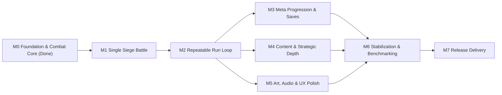

# ProjectNeo Implementation Roadmap

Last Updated: 2026-11-13 00:35:13 (KST). **Current Milestone: M1 Single Siege Battle in progress; M2 Repeatable Run Loop in progress in parallel.** Merged `syj`'s Title/Game flow (G-0, G-1), wall stacking / overlapping unit elevation, and `feature/siege-prototype` test scene (prep, assault, ladders, win/loss) into `develop`. `SiegePrototype` tests parts of B-6/B-9 separately; the actual `Game` scene links 1st-person prep / construction F interaction → gate banner F interaction → enemy assault, ladders, actual win/loss → rewards/results. Placeholder start/outcome buttons are hidden in game view. On the M2 side, run data is linked to the Game scene (C-1~2), victory rewards are paid out (C-4), and prep has build/repair costs (D-2), facility pop-ups (D-0), facility upgrades (D-1), the shop (D-5), and player equipment (D-7); everything except C-1a still awaits a manual playtest (5.6). Formal stage/wave layouts, casualty replenishment, and spawning newly hired/recruited units into the scene (D-0b) are follow-ups. Teammate handles enemy assault and combat execution; User handles game entry and core flow (see 6.1). Wall-destroying enemies, aerial enemies, waves, morale, and siege weapon firing (Q-21) remain pending. Q-09 resolved in favor of Defeat priority.

This document manages target goals, development order, current status, immediate tasks, and 3-person collaboration plans. Original game design is in [GameDesign.md](GameDesign.md); code, execution, development principles, and Unity CLI commands are in [Context.md](Context.md); past verification history is in [History.md](History.md).

## 1. GOAL: Definition of Done

### 1.1 Final Objective

**Deliver a complete siege defense roguelike where players scout upcoming enemy waves, prepare heroes, troops, equipment, and walls, defend the castle through direct player combat and unit commanding, and carry forward casualties and rewards into subsequent battles.** Upon run termination, unlocks and perk points persist, empowering players to challenge new runs with diverse strategic configurations.

Beyond implementing feature lists, first-time players must intuitively grasp the game flow via in-game guidance, playing from start to designated run termination and restarting cleanly. The goal is a distributable, stable standalone executable featuring final art, sound, UI, and performance.

Target release platforms, distribution channels, release dates, and final content scale are **undecided**. Having a Windows build pipeline does not imply final platform selection. This roadmap omits unverified dates or arbitrary stage counts. Run termination rules remain open; specific bosses or clear conditions are not yet locked.

### 1.2 Final Completion Criteria

| Dimension | Verification Target in Final Release |
|---|---|
| Core Gameplay | Scouting wave composition drives preparation choices that visibly impact combat outcomes. Encourages experimenting with multiple squad, gear, and wall configurations over repetitive single meta-builds. Validated via playtests. |
| Siege Combat | Ground and wall-top combat, structural collapse, walkable path shifts, squad commands (Move/Attack/Hold), diverse enemy approaches, morale/rout mechanics, and win/loss conditions operate cohesively. |
| Prep & Progression | Facility interactions (hire, recruit, trade, craft, fortify, organize) seamlessly reflect into combat and subsequent prep phases. Skill and perk effects functionally wire into runtime stats. |
| Run Loop Completeness | Start → Prep → Battle → Rewards → Next Stage → Finalized termination rules → Results → Retry loop functions without interruption. Wall damage, hero permadeath, grunt casualties, and rout returns carry over accurately. |
| Meta Progression & Saves | Commander EXP, perk points, unlock points, and unlock states persist across sessions. Perks reset cleanly upon starting new runs. Robust handling for save failures, corruption, and version migrations. |
| Content & Expression | Delivers finalized initial release scope of heroes, enemies, stages, items, and perks. Visual and acoustic feedback clearly differentiate attacks, threats, commands, damage, death, and routs. |
| Usability | First-time tutorialization, controls, commands, preparation, and retry flows are clear. Responsive input handling, configurable settings, and legible UI. |
| Quality & Delivery | Target specs, troop headcounts, and frame rate targets met in release builds with production models and animations. Zero progression-blocking or save-destroying defects; verified packaging and distribution pipeline. |

### 1.3 Scope & Roadmap Granularity

- **Core Release Scope:** Siege combat, preparation facilities, run iteration, meta progression, UI, skill integration, save systems, audio-visual feedback, and verification.
- **Initial Verification Scale:** Validate core loops using minimal content slices. Intermediate 3-stage tests are test slices, not final run lengths.
- **Mechanics Requiring Further Assessment:** Jump, guard, directional melee attacks are candidate follow-ups. Necessity evaluated post-playtest.
- **Candidate Post-Launch Expansions:** Exterior foraging expeditions, hero loyalty, difficulty modes. Not blocking core GOAL completion.
- **Horizon Granularity:** Immediate M1 is fully detailed down to task prerequisites, deliverables, and assignments. Intermediate M2/M3 plan feature bundles and integration gates. Distant M4+ maintains milestones and completion criteria only, refined when reached.

### 1.4 Established Design & Implementation Decisions

| Item | Decision | Implementation Impact |
|---|---|---|
| Art Style | Low-poly, Synty assets. Pack undecided; build decoupled modular architecture prior to pack selection. | Decouple grid size, cell footprint, height, and visual prefabs into data assets. Adaptable to final packs without code refactoring. |
| Combat Perspective | 3D First-Person (revised 2026-11-11). | Direct movement, attacks, and squad commanding performed at eye-level. Orthographic camera reserved for construction. Measure performance early with hundreds of 3D entities. |
| Castle & Map | Single castle throughout run; walls and structures placed freely on grid. | Placement systems and dynamic pathfinding updates integrated into combat prototypes. |
| Grunt Recruitment | Recruited at barracks; rescued prisoners act as supplemental reinforcements. | Barracks features dual functions: Training (enhancement) and Recruitment. |
| Monster Materials | Multiple distinct material types. | Costs and wallets track materials per specific definition (Implemented). |
| Perk Effects | Extends beyond raw stats to unique gameplay modifiers (e.g., squad morale boost). | Perks hold effect payload lists; modular effect expansion architecture. |
| Squad Sizing | Data-driven configuration. | Tuned via ScriptableObjects. Default: 4 squads × 10 members. |
| Facility Trading | Buying/selling at shop and blacksmith; inventory pools update with facility tiers. | Data-driven inventory pools per tier. Unified trading transaction logic. |
| Run Persistence | Two elements persist: Perk point pool count and Unlocks (items, heroes). | Spent perks reset on death; accumulated pool survives. Save data stores points, unlocks, Commander Level, and Unlock Points. |
| Perk Points | Awarded via Commander Level and related milestones; multiple acquisition sources supported. | Extensible architecture supporting multiple EXP and perk point sources. |
| Commander EXP | Granted upon stage completion. Mid-run level ups award instant perk points for real-time power scaling. | Level-ups and perk awards processed immediately upon stage reward distribution. |
| Reincarnation Bonus | Score converted to Commander EXP at run termination based on fixed ratio. | Conversion ratio configured via data asset. Scoring formula defined in Stage C. |
| Perk Allocation | Allocatable at any point, not restricted to run initialization. | Unspent points spent anytime; instantly updates stats and active effects. |
| Unlocks | Spent unlock points trigger randomized unlocks (e.g., 100 points unlocks a hero pool entry). | Gacha-style unlocking per category. Supports guaranteed initial appearances. |
| Wall Breached | Main gate destruction constitutes complete breach. | Defeat triggers if main gate falls AND all defenders die/rout, OR if player character dies. |
| Wall-top Combat | Defenders fight atop ramparts. | Wall surfaces are walkable navigation meshes; multi-tier pathfinding across ground and ramparts. |
| Enemy Wall Strategies | Ground enemies breach walls or climb ladders; flying enemies directly assault ramparts. | Modular behavioral AI composed via data; supports breach, climb, flight. |
| Grunt Casualties | Slain grunts permanently lost; only routed grunts return for next combat. | Combat results track deaths and routs as distinct metrics. |
| Material Items | Reward material items are identical to monster materials. | Unified material item classification. |
| Player Character | Controllable hero sharing identical stats, skills, items with NPC heroes. | Common character architecture; differs only in control driver (Input vs AI). |
| Item Sales | Selling price is fixed percentage of purchase price; items from all sources sellable. | Sale percentage data-driven; universal sale valuation across all items. |
| B-2 Controls | WASD move, mouse look, Left-click frontal melee attack. | Jump, guard, directional attacks deferred as follow-ups. |
| B-3 Combat Rules | Damage = Attack - Defense (min 1). Auto-targets closest enemy; retargets on death/unreachable. No friendly fire. | Damage logic decoupled in pure C#. Validates team filters and reachability. |
| B-3 Ranged Combat | Linear projectile fired toward target; dodgeable. Blocked by walls, passes allies. | Swept volume / raycast collision between frames prevents tunnelling at high speeds. |
| B-4 Stairs & Collapse | Independent stair placement. Wall collapse causes units to fall, suffering height-based damage. | Stair connectivity hints, falling, landing, NavMesh recovery. Fall damage data-driven. |
| B-4 Build Preview | Angled overhead orthographic view, translucent preview, Left-click place, Right-click cancel, R rotate. | Preview has zero collision/occupancy impact. Overlapping living units elevated to top surface harmlessly (revised 2026-11-11). |
| Siege Weapon Extensibility | Cannons are one weapon archetype; architecture must accommodate diverse future siege weapons. | No cannon-specific hardcoding. Shared mount, support, and collapse rules; weapons added via data definitions and modular behavior components. |
| B-4.6 Weapon Collapse | Destroying supporting wall piece simultaneously destroys mounted siege weapons. | Weapons listen to support destruction events and clean up instantly without falling. |

## 2. Pending Decisions & Decision Points

**Backlog Operation Decision (2026-11-12):** Select an unclaimed task from [Docs/Backlog.md](Backlog.md), mark `In Progress` with assignee name, and immediately commit/merge (push/sync) the file before starting implementation to prevent collisions. Never touch another assignee's in-progress tasks. Update docs and backlog upon completion.

**Branch Lifecycle Decision (2026-11-12):** After selecting and claiming a backlog task, sync the latest shared `develop` (including the claim) and create a dedicated `feature/<task-description>` branch from it before implementation. Record the branch name in the backlog. After the user merges the work into `develop` and the merge is confirmed on the remote, delete the corresponding remote task branch. Retain unmerged work branches. This keeps the remote branch list small and makes cross-agent references easier. General code commits and merges remain user-owned. Operational rules follow AGENTS.md; assignments and contracts follow Section 6.

**PERF-nav-query coordination (2026-11-12):** User confirmed no competing edits and authorized shared `UnitCombatAI.cs` target-search changes. Honor existing DecisionInterval for empty-target searches; retain immediate invalidation of existing targets and exact combat range/LoS rules. No serialized data or morale/assault contract changes.

| ID | Decision Topic | Needed By / Blocking | Current Status |
|---|---|---|---|
| Q-01 | Synty pack and finalized piece specifications | Production art integration | Undecided. Generic modular architecture approved. Dimensions configured via assets. |
| Q-02 | Fall damage upon wall collapse | B-4.5 | Resolved: Units fall and take damage proportional to height; tuned in assets. |
| Q-03 | Stair placement for wall ascent | B-4.1, B-4.4 | Resolved: Placed manually by player inside castle. |
| Q-04 | Morale decay, rout thresholds, rout navigation, retreat triggers | B-8.1, B-8.2 | Resolved (2026-11-12): 0–200 scale, start 150, once-per-battle check at 100 (Collapse / 25% Awaken), effects last the battle, whole-squad rout at 0 to a courtyard retreat point, squad-held morale carried between battles (+20 after battle, routed squads floor 80), enemy loss causes, enemy rout at 0 counted as exit alongside Q-30, minimal test HUD. All values in data. See GameDesign "Ally Morale: Breaking Point" / "Enemy Morale". Prep-phase recovery facilities deferred. |
| Q-05 | Impact of squad captain death on squad efficiency | B-5 squad, B-8 integration | Resolved (2026-11-12): Captain death lowers squad morale by the largest fixed amount; the captain routs with the squad at 0. Captain-less squads still obey orders is confirmed. |
| Q-06 | Mid-combat perk allocation and pause behavior | M2 perk hook, M3 UI | Undecided. Previous candidate: restricted to prep/reward phases. |
| Q-07 | Unlock point distribution timing, gacha UI location, guaranteed appearance policy | M2 reward contracts, M3 unlock UI | Partial: Gacha appearance flags in data; distribution timing pending. |
| Q-08 | Run score formula, run duration, ending conditions, boss roles | M2 score/reincarnation, M4 scope | Partial (2026-11-11): Clearing all stages triggers ending. Stage count, boss roles, scoring metrics undecided. |
| Q-09 | Priority on simultaneous victory and defeat triggers | B-9.1 finalization | Resolved (2026-11-12): Defeat takes precedence if both occur simultaneously. |
| Q-10 | Final troop headcount, baseline gear, performance budget | Art integration, M6 benchmarking | Undecided. B-1 500-unit test is not a production guarantee. |
| Q-11 | Command keys, combat HUD, prep UI layout | B-5.3, M2 UI | F1–F10 enabled in Siege prototype. Default command keys: F1–F4 select, ` all, 1 Move, 2 Attack, 3 Hold (rebindable in Input System). HUD layout undecided. |
| Q-12 | Initial skill/consumable rules, cooldowns, targeting, specific perk effects | M2 minimal skill/item execution | Undecided. Skills currently exist as identifiers only. |
| Q-13 | Mid-run saves, resume capability, save slots | M2 lifecycle, M3 persistence | Meta save is mandatory; mid-run save unconfirmed. |
| Q-14 | Release platforms, distribution channels, launch dates, playtime, content scale | M4 scope, M7 delivery | User response: Undecided. Focus on core completion criteria first. |
| Q-15 | Supported input devices, settings, languages, accessibility baseline | M2 framework, M5 production UI | Undecided. Avoid arbitrary additions. |
| Q-16 | Build camera and placement controls | B-4.7 | Resolved: 45-degree diagonal orthographic camera, translucent preview, Left-click place, Right-click cancel, R rotate. |
| Q-17 | Independent stair placement & overlapping unit handling | B-4.2, B-4.7 | Resolved: Stairs placeable independently. Placements overlapping living units elevate them to top surface harmlessly (revised 2026-11-11). |
| Q-18 | Vertical stacking & lateral cantilevering | Future expansion review | Superseded by Q-27 (2026-11-11): Layer stacking implemented. No unsupported cantilevering. Mounted weapon points decoupled from ground footprint. |
| Q-22 | Squad directive behaviors & auto-targeting priority | B-5.1, B-5.2 | Resolved (2026-11-11, revised 2026-11-12): Move ignores enemies to destination. Hold defends post: melee engages walkable enemies within 6m (`HoldEngageRadius`), ranged shoots within range and advances toward reachable enemies within range + 6m (`HoldRangedChaseExtra`). Attack advances toward point, pursuing visible enemies encountered on the way. Default state is Hold. Vision based on `UnitAISettings.DetectionRange`. |
| Q-23 | Unreachable destinations, broken paths, stalled formations | B-5.4 | Resolved (2026-11-11, 2026-11-12 BUG-wall-hold): Units halt at closest reachable point. If stalled within 1.5m of destination without 0.1m progress over 0.5s, considered arrived and transition to Hold. |
| Q-20 | Handling mounted structures when supporting wall collapses | B-4.6 | Resolved (2026-11-11): Mounted cannons and structures destroyed simultaneously with supporting piece. |
| Q-21 | Siege weapon mechanics: firing, control mode, HP, targetability, range, reload, cost | Pre-weapon implementation | Undecided. Cannons are currently non-firing, non-colliding visual placeholders. |
| Q-19 | Construction camera rotation | Build camera wiring | Resolved: Q orbits 90 deg left, E 90 deg right around screen pivot. Smooth transition (0.3s). Coordinates preserved. |
| Q-24 | Camera perspective across test scenes | B-5.4 integration scene | Resolved (2026-11-11): Default play perspective changed to 1st-person across Combat, SquadCommand, and Game scenes. Orthographic view reserved for construction. |
| Q-25 | Scene architecture: Boot scene vs monolithic scenes | G-0 scene transitions | Resolved (2026-11-11): Two scenes: Title and Game. Entire run takes place in Game scene without reloading. Shop/facilities open as pop-up UI. |
| Q-26 | Collaboration workflow: Separate PCs/branches vs shared editor | G-0 scene/asset setup | Resolved (2026-11-11): Separate PCs and separate git branches. Coordinate before touching shared project settings. |
| Q-27 | Castle modularity: 3m grid vs vertical stacking vs 1m voxels | Map setup, D-2 build UI | Resolved (2026-11-11): Option A adopted (Current grid + vertical stacking up to 3 tiers). |
| Q-28 | Siege prototype scope & breach mechanics | B-6, B-9 prototype | Resolved (2026-11-11): Dedicated prototype scene. Prep phase allows building/squad placement. Ground melee attack gates or climb ladders; archers shoot upward at 50% damage. Ladders spaced every 5 cells, toppled by allies. |
| Q-29 | Ladder spacing, raising/toppling timings, enemy siege roles | Siege prototype | Resolved (2026-11-11): Fixed ladder slots along walls. Raise: 3s; Topple: 2s; Climb: 2.5s. Enemies split into Ladder Grunts, Gate Breakers, and Archers. |
| Q-30 | Handling isolated surviving enemies outside castle (e.g. lone archer) | Siege prototype / B-8 | Resolved (2026-11-12): If no siege-capable enemies remain and no walkable path exists to surviving defenders, enemies retreat off-map and flee. Victory declared when all enemies die or flee. |
| Q-31 | Equipment retention upon hero permadeath | C-3 casualty carry-over | Undecided. C-1a preserves fallen hero gear in `RunState.FallenHeroes`. |
| Q-32 | Can player character serve as squad captain | D-8 squad setup UI | Undecided. C-1a `TrySetLeader` permits assigning player character. |
| Q-33 | Facility pop-up UI framework and structure | D-0 facility framework | Resolved (2026-11-12): uGUI + TMP modal pop-ups. Displays title, level, gold, materials, body, close (Esc). |
| Q-34 | Shop/tavern inventory refresh cadence and gold re-rolling | D-5 shop, D-3 tavern | Resolved (2026-11-12): Inventories re-roll deterministically via run seed upon entering each prep phase. Gold re-rolling deferred as follow-up. |
| Q-35 | Blacksmith crafting model (storefront sales vs recipe crafting) and upgrades | D-6 blacksmith | Undecided. Requires crafting recipes and gear enhancement state definitions. |
| Q-36 | Deployment mechanics for hired heroes and recruited grunts | D-0b spawning, D-3 tavern, D-4 barracks | Resolved (2026-11-13): Recruits/hires choose a squad in the facility UI (grunt default: first squad with space). Full squads → auto-create a new squad up to the cap, then block recruiting. Hiring onto a captained squad swaps captains; displaced hero goes to reserve (excluded from `BattleInput`) until D-8. New units spawn in front of their facility during the current prep and walk to their squad. Details in GameDesign "Unit Deployment". |

### 2.1 Decision Records Outside the Table

- **Stacking on the gate (2026-11-11, user request):** Walls may be stacked on top of the main gate during prep. No building during battle (user confirmed). When the gate is destroyed, pieces above it drop by the normal settle rule. The gate's fixed floor position, demolition ban, and ban on new placement into its empty floor slot after destruction remain.
- **Player start position (2026-11-11):** User chose the courtyard. Overlapping units no longer block placement; they are lifted onto the new piece. Applied in `GameFlowSetup.ApplyDefaultCastle` and `Game.unity`.
- **Entering construction and unit handling (2026-11-11, wired 2026-11-12):** Prep defaults to walking the courtyard in 1st-person; the prep phase itself is not a build mode. Construction view opens only from the construction building: look at it up close and press F, Esc returns to the same position and view. Range and keys live in `Assets/_Project/Data/GameFlow/Interaction.asset`. Overlapping units are lifted onto the new piece without damage and their movement resumes after the NavMesh update (replaces the old Q-17 overlap rejection).
- **Real battle wiring (2026-11-12):** Battle starts with F at the starting point in front of the gate. Ladders reach the top of stacked walls. Walls above the gate drop when it falls, and gate breakers keep attacking pieces that dropped into the gate cell. `GameFlow` stays the single source of phase truth and the existing Game squads/castle are used. Simultaneous win/loss → defeat (Q-09); with no siege-capable enemies and no path to allies, remaining enemies retreat and victory follows (Q-30). `SiegePrototype` is kept as a separate test scene.
- **Map expansion (2026-11-12, user approved):** Before wiring battle into Game, the castle grew to 96×96m, courtyard 90×90m, ground 240×300m, with a 120m northern approach, five placeholder facilities, walkways, assembly space, and build-camera pan/zoom. The 3m wall unit stays. Exact layout values are test values; current state is tracked in 6.1 and Context.
- **Q-27 option A details (2026-11-11):** `BuildLayout` tracks layers per cell. Game grid (`Data/GameFlow/Grid.asset`) allows 3 tiers; prototype grids default to 1 tier, so older behavior and tests are unchanged. Detail rules made during implementation (not yet approved, listed in GameDesign walls section): no stacking on stairs, multi-cell pieces need equal support height, no stacking on weapon-holding pieces and no weapons on covered walls, dropped pieces keep HP and weapons, multi-cell pieces losing only part of their support are destroyed. Dropping is instant with no animation. Teammate note: breaking a wall makes the upper tier drop and refill the gap, so a 2-tier wall must be broken twice. Read layer via `BuildPlacement.Level` and floor height via `Elevation`. Options B (smaller cells + height steps) and C (1m voxels) were considered and rejected for cost; C would have required a new castle system and did not fit Synty wall assets.
- **C-1a decisions (2026-11-12, user chose all recommendations):** Scope is run data, combat I/O format, rules, and EditMode tests; Game scene wiring happens in C-1~2. Surviving heroes/grunts fully heal before the next battle, so run data stores no unit HP. Each grunt gets a unique in-run ID. The battle result format is a draft pending the combat teammate's review.
- **Current temporary implementation:** B-2/B-3 move speed, HP, attack, defense, range, windup, AI tick, detection range, projectile values, and camera settings are test asset values. B-3 "unreachable" means no complete NavMesh path. Final siege decisions for breaking, climbing, and flying expand in B-6.

## 3. Current Status & Starting Point

### 3.1 Implemented vs Pending Real Connections

| Domain | Verified Current State | Remaining Integration Scope |
|---|---|---|
| Project Foundation | Unity 6000.6.8f1, URP, 4 assemblies, test runners, Windows build script | Distribution packaging, release verification |
| Stats, Economy, Facilities | Stat modifiers, multi-material wallet, inventory, trade logic, facility level data | Interactive facility UIs, hiring/recruiting loops, crafting/upgrade workflows |
| Characters & Combat | 1st-person movement, melee attacks, health, grunt stats, projectiles, auto-combat, Game scene siege assault/ladders/outcomes | Wall-destroying/aerial enemies, active skills, consumables, production HUD |
| Meta & Perks | Progression curves, reincarnation conversion, gacha unlocks, perk payloads | Disk persistence, run reward routing, runtime perk injection |
| Squads, Morale, Walls | Squad structures, grid occupancy/rotation, wall/stairs placement, async NavMesh rebuild, fall damage, siege weapon mounting/collapse, 1st-person squad commands | Morale/rout mechanics, siege weapon firing, wall-destroying enemies, construction delays |
| Run Data Architecture | `RunState` container, castle persistence, combat I/O, single application rules (C-1a), Game scene unit binding, combat result routing, survivor healing (C-1~2) | Teammate format sign-off, spawning new units from hiring, loading saved runs into scenes, casualty replacement, meta file persistence |
| Test Scenes | `CombatPrototype` (controls), `UnitBattlePrototype` (10v10), `ConstructionPrototype` (building/weapons), `SquadCommandPrototype` (orders), `WallCommandPrototype` (integrated), `SiegePrototype` (siege assault) | Wall-breaching/aerial enemies, multi-wave sequences, morale routs, full loop integration |
| Art & Performance | Capsule/box placeholder visuals, dual-tier NavMesh benchmark | Production Synty packs, animations, VFX, full combat performance profiling |

**Earlier Test Pass Baseline:** EditMode **201 passed**, PlayMode **88 passed** on the D-7 branch `feature/player-equipment` (based on develop `d71f9b6`, which already contained D-5, D-1, and the BUG-wall-hold fix). After the D-7 merge (`050948a`), develop only received doc changes, but the suite has not been re-run on the merged develop itself. Physical F/Esc/I, middle-click, wheel, Home input and the Windows build remain for manual verification. Explicit performance tests are separate. Per-branch results are in History.md.

**PERF-nav-query:** Done; user confirmed manual Game scene verification and requested final integration. Implementation `22061ac`, merged into develop `f7207f3`; latest teammate backlog changes preserved. Full integrated PlayMode 91/91 passed (38.15s) under temporary focus-independent synthetic keyboard routing, then settings restored. Default unfocused input tests failed 3/91; follow-up BUG-playmode-input-focus is registered. Editor benchmark improvement and repeat/manual steps: History PERF-nav-query and Context Section 6. Standalone performance not measured. Remote develop push confirmed (`59c262d`); remote and local task branches deleted after ancestry verification.

### 3.2 Status Conventions

`Not Started` → `In Progress` → `Waiting for Link` → `In Verification` → `Done`. Use `Pending Decision` for design gaps and `Waiting for Prerequisite` for upstream blockers.

## 4. Project Milestones

| Milestone | Scope & Major Deliverables | Prerequisites | Completion Criteria | Status |
|---|---|---|---|---|
| M0 Foundation & Combat Core | Data structures, player controls, baseline combat, initial performance profiling | Project setup | Verified A, B-1~3 deliverables | Done |
| M1 Single Siege Battle | Walls, placement, dual-tier navigation, squad commands, enemy siege AI, ladders, win/loss | M0, core contracts | Defend castle via direct combat and commands; structural collapse and outcomes verified | In Progress (Prototypes operational; Game scene integrated) |
| M2 Repeatable Run Loop | Run state, prep facilities, squad setup, wave preview, rewards, casualty carry-over, minimal skills/perks | M1 integration | 3-stage loop: Prep → Combat → Rewards → Next Stage / Defeat Results | In Progress (C-1a Done; C-1~2, C-4, D-0, D-1, D-2, D-5, D-7 implemented and awaiting manual verification) |
| M3 Meta Progression & Saves | Disk persistence, unlocks, perk loadouts, run score, reincarnation bonuses | M2 contracts | Persistent meta across sessions; perk re-allocation; dynamic unlock pools | Core rules drafted |
| M4 Content & Strategic Depth | Content scope finalization, hero/enemy/item/stage rosters, boss encounters, economy tuning | M2 playtest feedback, M3 progression | Viable multi-build strategies across full run lengths | High-level planning |
| M5 Art, Audio & UX Polish | Synty asset swap, animations, VFX, audio, production UI, tutorialization | M2 stable loop, Q-15 | Intuitive onboarding and polished sensory feedback | High-level planning |
| M6 Stabilization & Benchmarking | Full production profiling, memory/load testing, balance pass, bug fixing | M3~5 integration | Sustained target frame rates, zero blocking defects | High-level planning |
| M7 Release Delivery | Final freeze, standalone installer verification, store compliance, credits | M6 pass, Q-14 | Distributable golden master build meeting GOAL checklist | High-level planning |

### 4.1 Criteria for M1 to M2 Transition

Transition requires full cohesion: player, squads, walls, enemies, morale, and win/loss operating within the same combat session, resetting cleanly between runs.

### 4.2 M2 Sub-Batches

| Batch | Tasks | Completion Gate |
|---|---|---|
| C-1~2 State & Flow | Run data ownership, prep/combat/reward transitions, combat I/O, entity IDs | Run state survives combat entity destruction; subsequent battles reconstruct cleanly. |
| C-3 Casualties & C-6 Construction | Wall HP, hero permadeath, grunt casualties/rout returns, construction pacing | Accurate carry-over of HP, troops, and structures without duplicate application. |
| C-4~5 Rewards & Intel | Materials, gold, items, prisoners, EXP, unlock points, wave scouting | Deterministic reward rolling; upgrades reflect immediately into subsequent phases. |
| D-1~2 Prep & Fortification | Facility selection, currency, launch triggers, build/repair/upgrade economy | Seamless preparation phase economy; combat lockdown enforced. |
| D-3~8 Facilities & Squads | Tavern, barracks, shop, blacksmith, equip, squad organization, upgrades | Recruitment, trade, and organization reflect into runtime battle stats. |
| C-X Runtime Effects | Minimal skill/consumable execution, perk stat hooks, dynamic combat triggers | Effects functionally verified in runtime combat. |

### 4.2.1 D Facilities & Organization Tasks (2026-11-12 Breakdown)

| ID | Task | Prerequisites | Completion Criteria | High-Contention Files |
|---|---|---|---|---|
| D-0 | Facility Common Framework: `RunState` holds 5 facility states, definitions, F interaction / Esc exit pop-ups, input freezing, currency displays | C-1~2 / Q-33 | 4 courtyard buildings open/close modal pop-ups; locked during battle; level resets on new run | `Game.unity`, `GamePhaseView`, `PreparationInteraction` |
| D-1 | Facility Upgrades: Upgrade button and cost display in pop-ups | D-0 | Deducts gold from run wallet; upgrades tier; rejects if unaffordable; boosts pools | |
| D-5 | Shop: Rolls items per facility tier via run seed; buy/sell logic | D-0 / Q-34 | Trade transactions with run wallet/inventory; deterministic per seed | |
| D-0b | Spawning Run Units into Scene: Prefab references on definitions, `RunUnitBinding` spawning path, squad list refresh | C-1~2 / Q-36 | Recruited grunts appear in scene for next prep; join commands and combat tallies | `HeroDefinition`, `SoldierDefinition`, `SquadCommandCenter`, prefabs |
| D-4 | Barracks: Recruit grunts (type, cost, squad assignment) and apply stat buffs | D-0, D-0b, D-1 / Q-36 | Recruited grunts enter battle; stat upgrades apply across units | `CharacterActor` |
| D-8 | Squad Organization: Reassign grunts, designate hero captains, headcount caps | D-0, D-0b / Q-32, Q-36 | UI rearrangements reflect directly into battle commands and combat inputs | `SquadCommandCenter` |
| D-3 | Tavern: Hero pool rolls (unlocked heroes, facility tier), hiring logic | D-0, D-0b, D-8 / Q-34, Q-36 | Hired heroes enter run roster; join squads; permadeath applies | |
| D-7 | Equipment: Equip UI, bind run hero `Character` to scene actors | D-0 (heroes: D-3) / Q-31 | Equipping alters scene actor stats; items persist in run containers | `CharacterActor` |
| D-6 | Blacksmith: Craft, upgrade, sell equipment | D-0, D-1, D-7 / Q-35 | Craft items via materials/gold; upgrades boost item stats | `ItemInstance` |
| D-2 | Build Economy: Spend run gold on construction/repairs | C-1~2 / Costs | Build, demolish, and repair spend run gold; locked during battle | `ConstructionWorld`, `PlacementController` |

Recommended Order: D-0 → D-5 → D-1 → D-2 → D-0b → D-4 → D-8 → D-3 → D-7 → D-6. D-5 and D-2 do not share files with D-0b and could be split between people. Consumable use (Q-12) and unlock point spending (Q-07) are not in this batch.

Rules that already existed before this batch: facility levels, upgrade costs, item/hero pools, barracks stat modifiers (`FacilityDefinition`, `FacilityState`), shop rolls/buy/sell/sale ratio (`ItemShop`, `EconomyConfig`), equipping (`Character.TryEquip`), hire/recruit cost slots (`HeroDefinition.HireCost`, `SoldierDefinition.RecruitCost`), unlock gacha (`UnlockGacha`). Still missing: spawning new units into the scene, blacksmith crafting/upgrade data, and linking hired heroes to scene characters.

### 4.3 When to Detail M3 and Later

- Before M3: break down save targets, timing, versioning, and failure handling, plus unlock and perk UI flows. Keep E-1~4 as tracking IDs for this stage.
- Before M4: agree with the user on final content counts, run length, whether bosses exist, and target play time. Do not pre-create production tasks for undecided counts.
- Before M5: decide production and optimization approach from swap tests of a representative character, wall, and UI plus profiling results. Do not add new input devices or languages automatically.
- Before M6: fix measurement conditions (hardware, troop count, frame rate, memory) and defect priorities. Do not pass on test counts or editor average frame rate alone.
- Before M7: once a distribution channel is chosen, build a checklist for install, save paths, permissions, versioning, credits, and store materials. Paid services or platform integrations are planned only after a separate decision.
- Foraging, loyalty, and difficulty modes are separate scope reviews after M7. Old F-stage content/art/balance items were split into M4~6.

## 5. M1 Detailed Plan

### 5.1 Shared Contracts: B-0

- **B-0.1**: Grid coordinates, piece orientations, layers, heights, gate zones, entity IDs.
- **B-0.2**: Unit/squad IDs, Move/Attack/Hold command states, priority rules.
- **B-0.3**: Wall modification, NavMesh rebuild, death, rout, combat termination events.
- **B-0.4**: Shared file ownership, isolated verification scenes, sequential merge ordering.

### 5.2 B-4 Walls & Placement

- **B-4.1**: Grid & piece definitions, rotation, footprints, gate zone data. (Verified)
- **B-4.2**: Placement validity, bounds checking, occupancy mutation. (Verified)
- **B-4.3**: Wall/gate/stairs entities, health, destruction events, visual decoupling. (Verified)
- **B-4.4**: Ground-to-wall connectivity, stair climbing, vertical path queries. (Verified)
- **B-4.5**: Async NavMesh updates on collapse, fall damage, landing recovery. (Verified)
- **B-4.6**: Siege weapon mount points, support validation, concurrent destruction. (Mounting and collapse verified; Waiting for Link because firing, damage, and weapon HP depend on Q-21)
- **B-4.7**: Placement controls, preview rendering, integrated test scene. (Verified)

### 5.3 B-5 Squads & Commanding

- **B-5.1**: Pure C# squad command state machine, selection, formation offsets. (Verified)
- **B-5.2**: Directive routing to AI (Engage, Hold, Move), auto-combat priority. (Verified)
- **B-5.3**: Input bindings (F1–F4, `, 1, 2, 3) and HUD indicators. (Verified)
- **B-5.4**: Wall-top commanding, stair traversal, path breakage, stall recovery. (Verified)

B-4/B-5 "Verified" means checked in the prototype scenes (`ConstructionPrototype`, `SquadCommandPrototype`, `WallCommandPrototype`). It does not mark B-4, B-5, or M1 as done. Captain heroes (Q-05) and final squad markers (M5) are later links. How to add a new siege weapon and current test values are in Context.

### 5.4 B-6 Enemy Siege Behaviors

The siege prototype and Game scene already cover ladder grunts, gate breakers, and archers. The items below are the remaining scope; see Backlog B-6.1.

| ID | Deliverable | Prerequisites | Completion Criteria |
|---|---|---|---|
| B-6.1 | Enemy archetypes and behavior list, target priority and switching contract | B-0.2~3, B-3, enemy behavior details confirmed | Entry, exit, and failure conditions are written for chase, unit attack, wall attack, climbing, and flying |
| B-6.2 | Ground enemies attacking walls/gates and entering breaches | B-6.1, B-4.3~5 | Enemies find a wall to attack even with no full path to a unit, then enter through the opened path. Conflicts with the existing unreachable rule, so the combat integration owner merges it |
| B-6.3 | Climbing and flying enemy movement and attacks | B-6.1, B-4.4~5, climb/flight rules confirmed | Enemies do not give up on wall-top targets just because there is no ground NavMesh path; collision and range verified per movement type |
| B-6.4 | Data composition and three-type integration test | B-6.2~3 | Breakers, climbers, and flyers approach differently; a new type built from existing behaviors is added through data only. New behaviors themselves still need code |

### 5.5 B-7 Waves, B-8 Morale, B-9 Outcomes

| ID | Deliverable | Prerequisites | Completion Criteria |
|---|---|---|---|
| B-7.1 | Wave, spawn point, and timetable data plus spawn rules | B-6.1 enemy definition contract, B-0.3 | Spawns the configured types, counts, and timings from the same data; no duplicate spawns on pause/restart |
| B-7.2 | Enemy squad linking, corpse explosion, post-battle cleanup | B-7.1, B-6, B-8 result contract, explosion details | Spawning, enemy squads, and death effects apply once each in the real scene; no spawn state leaks into the next battle |
| B-8.1 | Squad morale, stat modifiers, rout transition math | Q-04~05, B-0.2~3 | Losses, boosts, limits, and rout transitions verified in EditMode |
| B-8.2 | Rout movement, exit, and result separation | B-8.1, command/movement wiring, Q-04 | Dead, routing, and exited are distinct and never double-counted; same rules for allies and enemies |
| B-8.3 | Hooks for morale skills, captains, and perk effects | B-8.1~2, effect event contract | A sample morale boost applies once to a real squad and its subscription is cleaned up. Full skill execution belongs to C-X |
| B-9.1 | Pure win/loss rules | Q-09, B-0.3 | All enemies dead/fled, gate-only destroyed, gate + allies wiped, player death, and simultaneous cases verified (defeat wins ties). Done in `SiegeOutcomeRules` |
| B-9.2 | Scene tallies, single end handling, result creation | B-9.1, B-4 gate, B-7, B-8.2 | Several deaths in one frame still produce one result and one reward request; no early victory while enemies are still scheduled to spawn |
| B-9.3 | M1 integration scene, repeated play, standalone build check | B-4~8 linked, B-9.2 | Prepare castle → direct combat + squad commands → destruction, morale, different enemy approaches → win/loss, repeated; B-2/B-3 regressions and build checked |

### 5.6 Early M2 Deliverables in M1

- **C-1a Status**: Done (`feature/run-data-boundary`). Pure C# `RunState`, `RunConfig`, `CastleState`, `BattleInput`, `BattleResult`.
- **C-1~2 Status**: In Verification (`feature/run-scene-connection`). Binds Game scene units to run IDs; records post-battle results; restores survivor HP.
- **C-4 Status**: In Verification (`feature/stage-rewards`). Payouts gold, materials, items, Commander EXP, and unlock points per victory.
- **D-2 Status**: In Verification (`feature/build-costs`). Build gold deductions, demolition refunds, repair execution.
- **D-0 Status**: In Verification (`feature/facility-frame`, merged `d146f35`). Courtyard modal pop-ups (F/Esc), input freezing, currency displays. The Siege facility has state only; its screen is the existing construction station.
- **D-5 / D-1 Status**: In Verification (`feature/shop-and-upgrade`, merged `681d08d`). User instruction: follow the design and leave unclear parts empty, adding only prototype functionality. `ItemShop` is attached to the run as `RunState.Shop` (`SetupShop`, `RestockShopIfNeeded`, `TryBuy`, `TrySell`). Stock rolls once per prep (per battles fought) from the current shop level's pool via the run seed, excluding locked items (Q-34). Sale price = gold price × sale ratio (`Data/GameFlow/Economy.asset`, 50%); reward items can be sold too. `RunState.TryUpgradeFacility` upgrades any facility from the run wallet; the pop-up shows the next cost or max level. Implementation choice: an upgrade does not re-roll this prep's stock and applies from the next prep (prevents free re-rolls). Tavern, barracks, and blacksmith only gain levels; their effects come with D-3, D-4, D-6. Shop items (wooden shield 25, leather armor 30, chain armor 60, steel sword 80 gold) and level pools are placeholder values. Out of scope: re-rolls, locked slots, material-cost goods, stock quantities above 1.
- **D-7 Status**: In Verification (`feature/player-equipment`, merged `050948a`). Player equipment only; hero equipment comes after D-3, and Q-31 affects heroes only. The run player hero reuses the scene player's `Character` (`RunUnitBinding.Create(..., playerCharacter)`, `RunState.AddHero(Character)`), so equipped stats apply in the scene without changing `CharacterActor`. `RunState.TryEquip`/`TryUnequip` accept only this run's heroes and stash items. Press I during prep (`PreparationInteractionSettings.Equipment`) to open `GameEquipment`. Implementation choice: slots are untyped and use the hero definition's slot count (player 3). Item effects are prototype values (iron sword attack +4, steel sword +8, wooden shield defense +2, leather armor +3, chain armor +6 and move speed −10%). Max HP effects are not used because equipping during prep would leave current HP below max. Out of scope: hero equipment, weapon/armor slot types, equipping in battle, equipment visuals.

Even with Q-13 undecided, keeping meta, run, and battle lifetimes separate is fine. Do not implement mid-run saves or unconfirmed result policies. Test with agreed result data instead of referencing wall or rout objects that do not exist yet.

## 6. Team Division of Labor

### 6.1 Assignment Matrix & Shared Modification Rights

| Assignee | Owned Scope | Locked Files (Do Not Touch) |
|---|---|---|
| Teammate | Enemy assault, siege behavior execution (B-6, B-7, B-8, B-9). | Scene flow framework, game entry scenes (`Title`, `Game`). |
| User | Game entry and loop architecture (G-0, G-1): Scene switches, Title → Prep → Combat → Reward/Results phases, run data lifecycle (C-1a, C-1~2). | Shared combat core (`CharacterActor`, `UnitCombatAI`), isolated enemy test scenes. |

The teammate scope (B-6~B-9) is our interpretation; confirm exact boundaries with the teammate. Design questions still go to the user first. The Developer 1/2/3 table in 6.2 is a reference for when the team grows.

**Prototype vs real scenes (2026-11-11, user confirmed):** All `*Prototype` scenes are mechanism demos. The real loop is built in new scenes (`Title`, `Game`) rather than chaining prototypes; prototypes stay as test scenes.

**G-0 / G-1 status: wired, awaiting manual playtest.** `Title` and `Game` scenes and flow rules (`ProjectNeo.Flow`) exist (G-0); the castle, construction, player, and squads are wired into Game (G-1). Prep is 1st-person walking with construction-station F and Esc back; battle is 1st-person control and commanding started from the gate banner F, with real enemy assault and win/loss through `GameBattleController`; rewards are paid out (C-4). Both scenes were appended to the build list; the first build scene is still `ConstructionPrototype`.

**Default castle (2026-11-12, user approved expansion):** Grid 80×100 cells (240×300m), 3m cells, up to 3 tiers. Outer wall 32×32 cells (96×96m), courtyard 30×30 cells (90×90m), northern field depth 120m. North gate, three stairs, placeholder tavern/shop/barracks/blacksmith/construction buildings, central walkway, and assembly area. The player starts at the south courtyard (40, 34); squads start at the northern assembly area. Build camera pan/zoom/Home reset is enabled in the game-only asset. Layout will be tuned through real play.

**Temporary in G-1 (not approved design):** 3 squads × 4 units are prototype values. Units, positions, and walls are not reset or replenished between stages except for survivor healing. The construction screen reuses the test `ConstructionHud`. No building during battle is a confirmed rule.

**Remaining:** formal waves, morale, and result data expansion; real map layout (inner keep, etc.); casualty carry-over (C-3); remaining facility features (D-0b, D-3, D-4, D-6, D-8); deciding whether Title becomes the first build scene and whether prototypes leave the build; run abandon / pause menu (no design yet).

**Battle–flow interface (2026-11-12):** `GameBattleController` starts on entering `GamePhase.Battle` via `GameSession.Flow.PhaseChanged` and calls `GameSession.Flow.FinishBattle` once when it ends; calls outside battle and second calls are ignored. With `GameRunLink` attached it passes a `BattleResult`; otherwise a plain `BattleOutcome`. Change the build list's first scene only after telling the teammate. Only one person edits `Game.unity` at a time. Generic frameworks (service locator, event bus) and save features (Q-13) are out of G-0 scope.

### 6.2 Parallel Workflow Matrix

| Batch | Developer 1 (Walls) | Developer 2 (Combat/AI) | Developer 3 (Flow/Run) | Exit Criteria |
|---|---|---|---|---|
| W0 Contracts | Grid/gate specifications | Command & AI interfaces | Run lifecycle & outcome contracts | Agree on B-0 contracts and file boundaries. |
| W1 Core Rules | B-4.1~2 Grid & placement logic | B-5.1 Squad command models | C-1a Run data contracts & tests | Verified pure C# unit tests. |
| W2 Scene Wiring | B-4.3~5 Wall physics & NavMesh | B-5.2 AI directives & B-6.1 archetypes | B-8.1 Morale & B-9.1 Outcome rules | Isolated scene test passes. |
| W3 Integration | B-4.6~7 Siege weapon mounting | B-5.3~4 Wall-top commanding | B-7.1 Spawn tables & B-8.2 Rout routing | Wall-top command integration verified. |
| W4 Full Combat | B-6.3 Ladder/aerial terrain support | B-6.2~4 Enemy siege assault | B-7.2 Cleanup & B-9.2 Outcome triggers | All roles active in shared siege scene. |
| W5 M1 Closeout | Pathfinding stress testing | Command & AI regression | Outcome & casualty persistence | M1 milestone sign-off; detail M2. |

### 6.3 Concurrency Principles

- Pure C# models and isolated tests execute fully in parallel.
- Modifying shared combat actors (`CharacterActor`, `UnitCombatAI`) requires sequential assignment.
- Shared prefabs, integration scenes, project settings, and packages are updated sequentially by assigned leads.
- Never execute compilation, PlayMode, tests, or builds concurrently in the same Unity editor instance.

## 7. Roadmap Governance

1. Check current milestones, recent decisions, and [Docs/Backlog.md](Backlog.md) before picking a task. Mark `In Progress` with assignee name and immediately commit/sync to prevent collisions.
2. User decisions must be recorded immediately in GameDesign.md and reflected in this roadmap.
3. Update task status, Context maps, and append verification details to History.md upon task completion. Mark `Done` in backlog and sync. After the user merges the work and remote `develop` integration is confirmed, delete the corresponding remote task branch.
4. Detail upcoming milestones upon completing major phases based on actual playtest feedback.
5. Explicitly differentiate automated test passes from playtest validation, individual scenes from integrated scenes, and editor execution from standalone builds.

