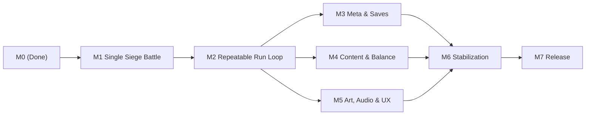

# Project Milestones & M2 Breakdown

Last Updated: 2026-11-13 13:17:37 (KST)

> Purpose: M0–M7 roadmap, M1→M2 criteria, M2 sub-batches, and M3+ detailing rules. | Parent: [INDEX](../INDEX.md) | Related: [Status](Status.md), [M1](M1.md), [Backlog](../Backlog.md)

## Milestones (M0–M7)

| Milestone | Scope & Major Deliverables | Prerequisites | Completion Criteria | Status |
|---|---|---|---|---|
| M0 Foundation & Combat Core | Data structures, player controls, baseline combat, initial profiling | Project setup | Verified A, B-1~3 deliverables | Done |
| M1 Single Siege Battle | Walls, placement, dual-tier nav, squad commands, enemy siege AI, ladders, win/loss | M0, core contracts | Defend castle via direct combat + commands; collapse and outcomes verified | In Progress |
| M2 Repeatable Run Loop | Run state, prep facilities, squad setup, wave preview, rewards, casualty carry-over, minimal skills/perks | M1 integration | 3-stage loop: Prep → Combat → Rewards → Next Stage / Defeat Results | In Progress |
| M3 Meta Progression & Saves | Disk persistence, unlocks, perk loadouts, run score, reincarnation bonuses | M2 contracts | Persistent meta across sessions; perk re-allocation; dynamic unlock pools | Core rules drafted |
| M4 Content & Strategic Depth | Finalize content scale, hero/enemy/item/stage rosters, bosses, economy tuning | M2 feedback, M3 | Viable multi-build strategies across full run lengths | High-level planning |
| M5 Art, Audio & UX Polish | Synty swap, animations, VFX, audio, production UI, tutorialization | M2 stable loop, Q-15 | Intuitive onboarding and polished sensory feedback | High-level planning |
| M6 Stabilization & Benchmarking | Production profiling, memory/load testing, balance pass, bug fixing | M3~5 integration | Sustained target frame rates, zero blocking defects | High-level planning |
| M7 Release Delivery | Final freeze, standalone installer, store compliance, credits | M6 pass, Q-14 | Distributable golden master build meeting Goal checklist | High-level planning |

- **M1 → M2 Transition**: Requires full cohesion: player, squads, walls, enemies, morale, and win/loss operating in the same combat session and resetting cleanly between runs.

## M2 Sub-Batches

| Batch | Tasks | Completion Gate |
|---|---|---|
| C-1~2 State & Flow | Run data ownership, prep/combat/reward transitions, combat I/O, entity IDs | Run state survives entity destruction; subsequent battles reconstruct cleanly. |
| C-3 Casualties & C-6 Construction | Wall HP, hero permadeath, grunt casualties/rout returns, construction pacing | Accurate carry-over without duplicate application. |
| C-4~5 Rewards & Intel | Materials, gold, items, prisoners, EXP, unlock points, wave scouting | Deterministic reward rolling; upgrades reflect in next phase. |
| D-1~2 Prep & Fortification | Facility selection, currency, launch triggers, build/repair/upgrade economy | Seamless prep economy; combat lockdown enforced. |
| D-3~8 Facilities & Squads | Tavern, barracks, shop, blacksmith, equip, squad org, upgrades | Recruitment, trade, and organization reflect into runtime battle stats. |
| C-X Runtime Effects | Minimal skill/consumable execution, perk stat hooks, dynamic combat triggers | Effects functionally verified in runtime combat. |

### D Facilities & Organization Tasks

| ID | Task | Prerequisites | Completion Criteria / Status | High-Contention Files |
|---|---|---|---|---|
| D-0 | Facility Common Framework (`RunState` 5 facilities, F/Esc pop-ups, freeze, currency UI) | C-1~2 / Q-33 | **Done**: 4 courtyard pop-ups open/close; locked in battle. | `Game.unity`, `GamePhaseView`, `PreparationInteraction` |
| D-1 | Facility Upgrades (cost display & level-up) | D-0 | **Done**: Deducts gold, levels tier, rejects unaffordable. | |
| D-5 | Shop (tier seed rolls, buy/sell) | D-0 / Q-34 | **Done**: Deterministic per seed; 50% sell ratio. | |
| D-0b | Spawning Run Grunts into Scene (`SoldierDefinition.UnitPrefab`, `RunState.TryRecruit`, `GameUnitSpawner`) | C-1~2 / Q-36 | **Done (2026-11-13)**: Recruited grunts spawn in front of facility, walk to squad, join battle. | `SoldierDefinition`, `SquadCommandCenter`, `SquadCommander`, `PlaceholderSquadMarkers`, `GameRunLink`, `Game.unity` |
| D-4 | Barracks (recruit grunts, choose squad, auto level training buffs) | D-0, D-0b, D-1 / Q-36, Q-37 | **Done (2026-11-13)**: Recruits pay gold, apply Lv2 +10% / Lv3 +20% HP & attack. | `CharacterActor` |
| D-8 | Squad Organization (reassign grunts, hero captains, caps) | D-0, D-0b / Q-32, Q-36 | UI rearrangements reflect into battle commands. | `SquadCommandCenter` |
| D-3 | Tavern (hero pool rolls, hire, captain swap, hero prefab/spawning moved from D-0b) | D-0, D-0b, D-8 / Q-34, Q-36 | Hired heroes spawn at tavern, walk to squad as captain; permadeath applies. | `HeroDefinition`, `SquadCommandCenter` |
| D-7 | Equipment (player equip UI, `Character` binding) | D-0 (heroes: D-3) / Q-31 | **Done**: Player equip UI (`I`) alters stats in scene (hero equip post-D-3). | `CharacterActor` |
| D-6 | Blacksmith (craft, upgrade, sell equipment) | D-0, D-1, D-7 / Q-35 | Craft via materials/gold; upgrades boost item stats. | `ItemInstance` |
| D-2 | Build Economy (build/demolish/repair gold) | C-1~2 / Costs | **Done**: Gold spent/refunded in prep; locked in battle. | `ConstructionWorld`, `PlacementController` |

Recommended remaining order: `D-8` → `D-3` → `D-6` (plus hero equip follow-up). Consumable use (`Q-12`) and unlock point spending (`Q-07`) are outside this batch.

## When to Detail M3 and Later

- **M3**: Break down save targets, timing, versioning, failure handling, unlock and perk UI flows. Reserved tracking IDs `E-1~4` remain until M3 starts, while new M3+ tasks use domain IDs (`META-01`~, `CONTENT-01`~, `ART-01`~, `UI-01`~, `AUDIO-01`~).
- **M4**: Agree on content counts, run length, bosses, target play time before creating production tasks.
- **M5**: Decide art/optimization approach from representative swap tests + profiling; do not add devices/languages automatically.
- **M6**: Fix measurement conditions (hardware, headcounts, FPS, memory) and defect priorities.
- **M7**: Build store/installer/save/permission/credits checklist once distribution channel is chosen.
- Foraging, loyalty, and difficulty modes are post-M7 scope reviews.
